<!-- .slide: class="title-slide" -->

# Warstwa fizyczna: przekaz elektryczny

## Kable miedziane w telekomunikacji i teleinformatyce

Mikołaj Leszczuk

---

## Plan wykładu

- kabel koncentryczny i jego złącza,
- para skręcona: budowa, rodzaje i zastosowania (w tym 100VG-AnyLAN),
- kable specjalne,
- RJ-45 oraz Token Ring.

---

<!-- .slide: class="section-slide" -->

# Kabel koncentryczny

---

## Budowa kabla koncentrycznego

  

  Powłoka zewnętrznaOplot / ekran
  Izolacja wewnętrznaPrzewód miedziany

- Angielska nazwa: *coaxial cable*.
- Ekran ogranicza wpływ zakłóceń elektromagnetycznych.
- W sieciach komputerowych został w większości wyparty przez skrętkę.

---

## Złącze BNC

*Bayonet Neill-Concelman*; dawniej sieci koncentryczne, dziś nadal aparatura pomiarowa.

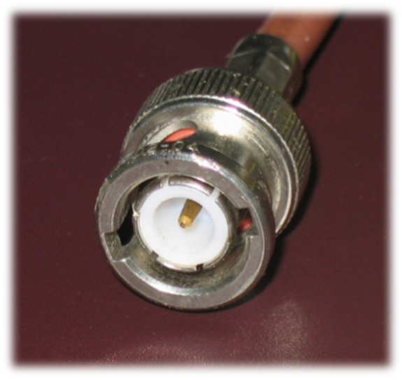

---

## Złącze N

Złącze stosowane dla sygnałów wysokiej częstotliwości, typowo do około 18 GHz. Jest większe i mechanicznie solidniejsze od BNC.

Na zdjęciach: u góry **wtyk**, u dołu **gniazdo**.

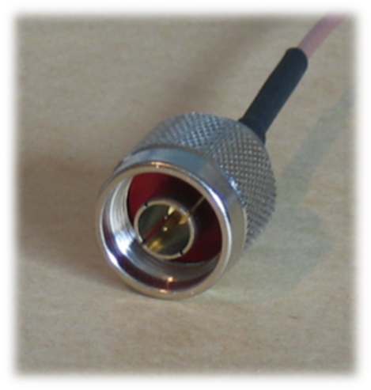
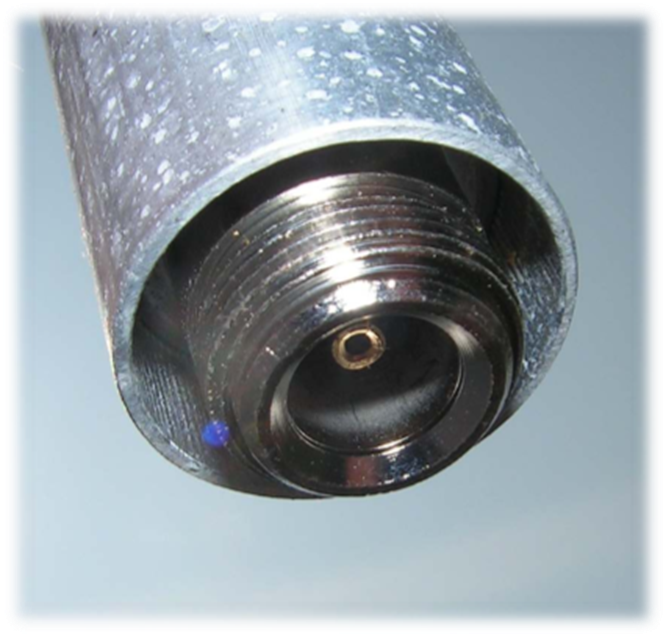

---

<!-- .slide: class="section-slide" -->

# Para skręcona

---

## Skrętka: podstawy

- Angielska nazwa: *twisted pair*.
- Osiem miedzianych żył tworzy cztery pary.
- Izolacja żył jest zwykle polietylenowa, a wspólna powłoka z PVC (*polyvinyl chloride*, polichlorek winylu).

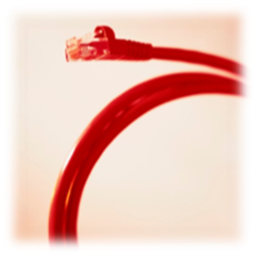

---

## Dlaczego przewody są skręcone?

Skręcanie żył pomaga ograniczyć zarówno zakłócenia odbierane przez parę, jak i zakłócenia, które para emituje.

<video data-youtube-fallback controls playsinline preload="metadata" poster="media/local-replacements/twisted-pair.jpg"><source src="media/local-replacements/twisted-pair.mp4" type="video/mp4"></video>

<a href="https://www.youtube.com/watch?v=P7WfY9P2uNY&amp;t=25s" target="_blank" rel="noopener noreferrer">Obejrzyj oryginał na YouTube</a>

Audio University / Kyle Mathias · Why Are Wires Twisted? · fragment 00:25.920–04:15.360

Różny skok skrętu poszczególnych par dodatkowo ogranicza przesłuch między nimi. Film pokazuje model idealnej linii symetrycznej; w praktyce tłumienie zakłóceń nie jest całkowite.

---

## Gdzie stosujemy skrętkę?

- sieci telefoniczne,
- sieci komputerowe,
- okablowanie strukturalne w budynkach.

Jej popularność wynika z dobrego stosunku możliwości do ceny oraz łatwości instalacji.

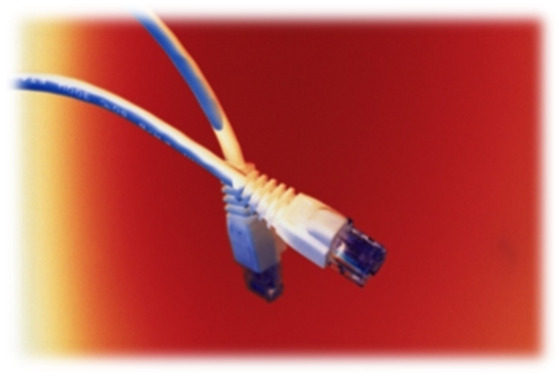

---

## Historyczne zastosowania kategorii skrętki

Film zestawia kategorie skrętki z historycznymi zastosowaniami: od telefonii i LocalTalk po Fast Ethernet. To przykłady, nie dzisiejsza tabela doboru kabli.

<video controls preload="metadata" poster="media/image31.png"><source src="media/slide-037-media5.mp4" type="video/mp4"></video>

---

## Skrętka zakończona złączem

  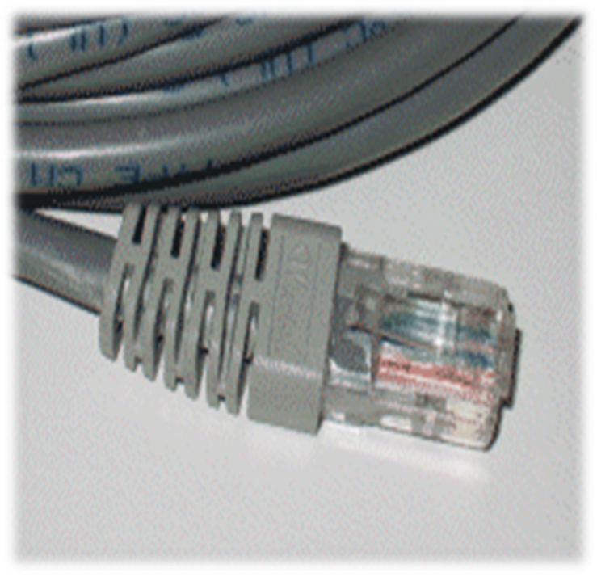
  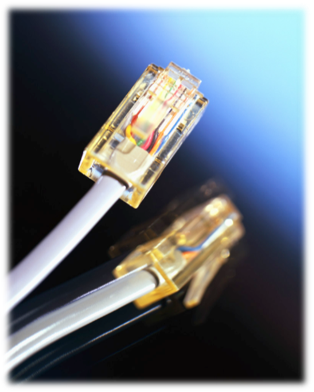

---

## Skrętka w 100VG-AnyLAN (IEEE 802.12)

- Wariant na nieekranowanej skrętce 100 Ω wykorzystywał cztery pary kategorii 3, 4 lub 5 i wtyk 8P8C (potocznie RJ-45), taki jak w okablowaniu Ethernetu.
- Sieć pracowała z szybkością 100 Mb/s i używała metody *Demand Priority*: koncentrator przydzielał stacjom dostęp do medium z uwzględnieniem priorytetu.
- Taki sam wtyk nie zapewniał zgodności portów z Ethernetem IEEE 802.3.

Standard jest <a href="https://standards.ieee.org/ieee/802.12/1172/">wycofany</a>. Przewidywał również warianty na ekranowanym kablu 150 Ω i na światłowodzie.

---

## Ekranowanie skrętki: U/UTP, F/UTP i S/FTP

Oznaczenie przed ukośnikiem opisuje ekran całego kabla, a oznaczenie po nim dotyczy par. Film porównuje kable bez ekranu, z folią i z oplotem.

<video data-youtube-fallback controls playsinline preload="metadata" poster="media/local-replacements/cable-shielding.jpg"><source src="media/local-replacements/cable-shielding.mp4" type="video/mp4"></video>

<a href="https://www.youtube.com/watch?v=Gf2shRh-5GU&amp;t=95s" target="_blank" rel="noopener noreferrer">Obejrzyj oryginał na YouTube</a>

Professor Messer · Cable Connectivity · 01:35-03:22 · po angielsku

<!-- study-only:start -->

---

## Rodzaje skrętek: UTP i FTP

**UTP — Unshielded Twisted Pair**

Bez ekranowania. Najczęstszy wariant w typowych sieciach lokalnych (LAN, *Local Area Network*).

**FTP / F/UTP — Foiled Twisted Pair**

Folia otacza cały kabel. Przydatna, gdy potrzebna jest dodatkowa ochrona przed zakłóceniami.

---

## Rodzaje skrętek: STP i S/FTP

**STP — Shielded Twisted Pair**

Określenie handlowe dla kabla ekranowanego; dokładną budowę należy sprawdzić w dokumentacji producenta.

**S/FTP — Screened/Foiled Twisted Pair**

Ekran z oplotu wokół kabla oraz folia wokół każdej pary. Stosowany w środowiskach o większych wymaganiach EMC (*electromagnetic compatibility*, kompatybilność elektromagnetyczna).

<!-- study-only:end -->

---

## Przykłady skrętek

  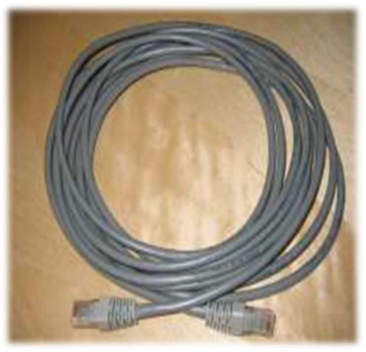
  
  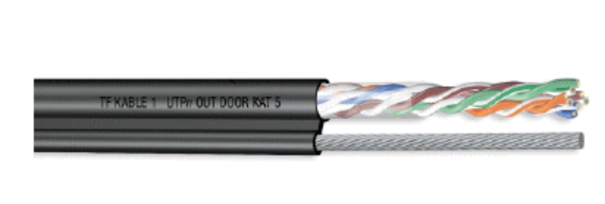

<!-- study-only:start -->

---

## UTP

- *Unshielded Twisted Pair*.
- Brak ekranowania żył.
- Najczęściej stosowany kabel w lokalnych sieciach komputerowych.

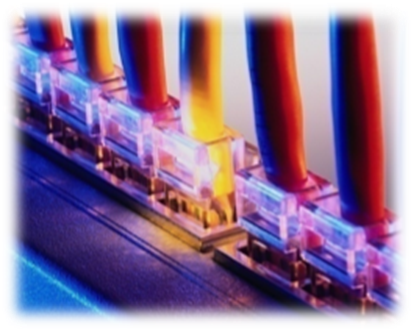

<!-- study-only:end -->

---

## Materiał: skrętka UTP

Na przekroju widać cztery pary, kolorową izolację żył i wspólną powłokę. Podane w filmie szybkości ilustrują starsze zastosowania.

<video controls preload="metadata" poster="media/image15.png"><source src="media/slide-017-media1.mp4" type="video/mp4"></video>

<!-- study-only:start -->

---

## FTP

- *Foiled Twisted Pair*.
- Ekranowanie folią oraz przewód uziemiający.
- Większa odporność na zewnętrzne zakłócenia elektromagnetyczne.

<!-- study-only:end -->

---

## Ekranowanie w praktyce

Oznaczenie STP (*Shielded Twisted Pair*) nie mówi, gdzie znajduje się ekran. O sposobie połączenia ekranu decyduje projekt instalacji, a nie samo oznaczenie kabla.

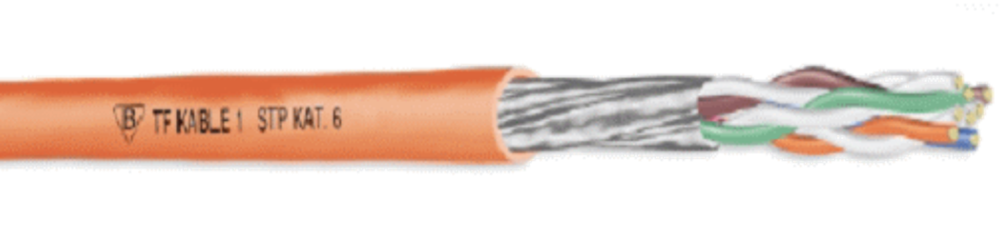

---

## Skrętka bez ekranu i z folią

  <figure><figcaption>Bez ekranu</figcaption></figure>
  <figure><figcaption>Z ekranem z folii</figcaption></figure>

---

## Kable ziemne

Wypełnienie żelowe ogranicza wnikanie i wzdłużne rozchodzenie się wilgoci w kablu prowadzonym na zewnątrz lub w ziemi. Ochrona przed zakłóceniami elektromagnetycznymi zależy od konstrukcji par i ekranowania, nie od samego żelu.

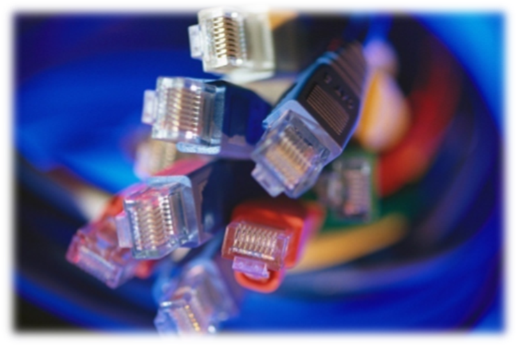

---

## Przewieszki

Kable z linką nośną prowadzi się między budynkami; dostępne są warianty UTP i FTP.

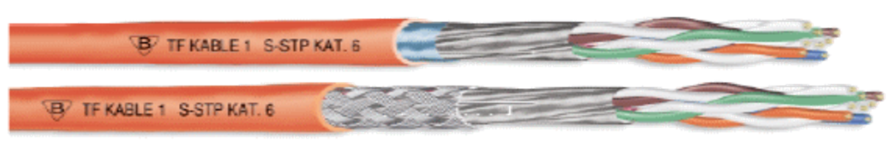

---

<!-- .slide: class="section-slide" -->

# RJ-45 i Ethernet

---

## Złącze RJ-45

- Ośmioprzewodowe złącze systemów okablowania strukturalnego.
- Normy międzynarodowe: ISO 8877, ISO/IEC 11801 i EN 50173.
- Dostępne są wersje ekranowane i nieekranowane.

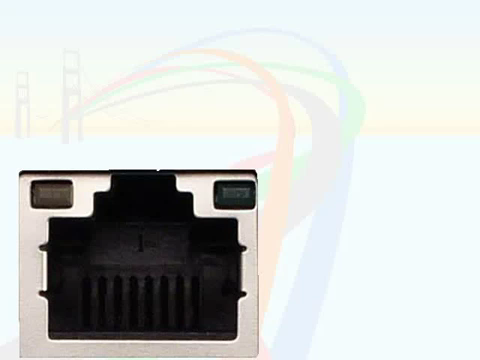

---

## Gdzie spotykamy RJ-45?

- w panelach krosowych,
- w gniazdach stanowiskowych,
- w kartach sieciowych,
- w kablach połączeniowych Ethernet.

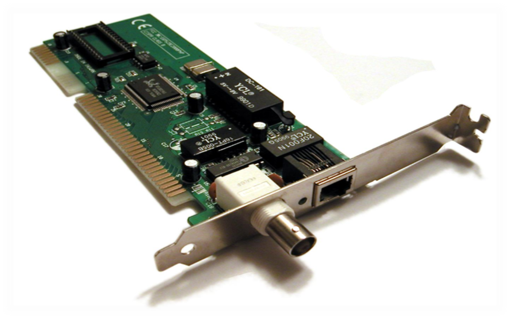

---

## Jak wtyk RJ-45 łączy się z gniazdem

Film zestawia wtyk z gniazdem i pokazuje, jak styki obu elementów trafiają na siebie po włożeniu wtyku.

<video controls preload="metadata" poster="media/image23.png"><source src="media/slide-029-media2.mp4" type="video/mp4"></video>

---

## Piny RJ-45

W dokumentacji technicznej można spotkać oznaczenie **8P8C**: osiem pozycji i osiem styków złącza.

12345678

Numerację ogląda się od strony styków wtyku, przy zatrzasku skierowanym w dół.

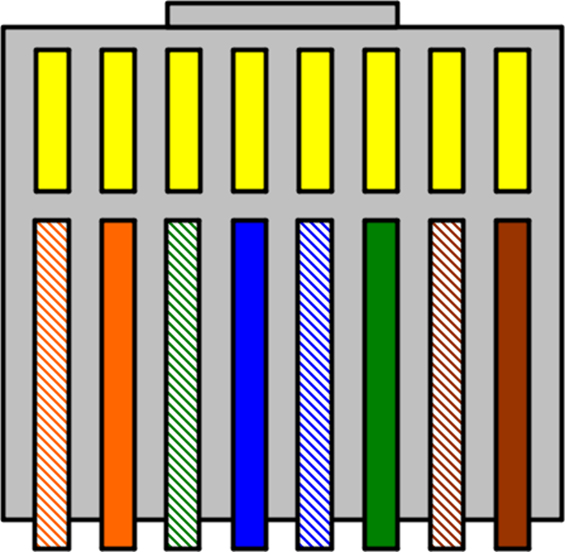

---

## Rozkład żył: T568A i T568B

Na dwóch schematach T568A i T568B porównaj położenie par zielonej i pomarańczowej. Niebieska i brązowa pozostają na swoich miejscach.

<video controls preload="metadata"><source src="media/slide-032-media3.mp4" type="video/mp4"></video>

---

## Kabel prosty

Kolejność żył jest taka sama na obu końcach kabla. To standardowy kabel łączący urządzenie końcowe z przełącznikiem.

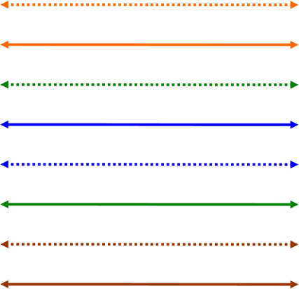

---

## Kabel skrzyżowany

Pary transmisyjne są zamienione między końcami kabla. Historycznie umożliwiało to bezpośrednie połączenie dwóch podobnych urządzeń bez przełącznika.

W pokazanym wariancie T568A/T568B zamieniają się piny 1 i 3 oraz 2 i 6.

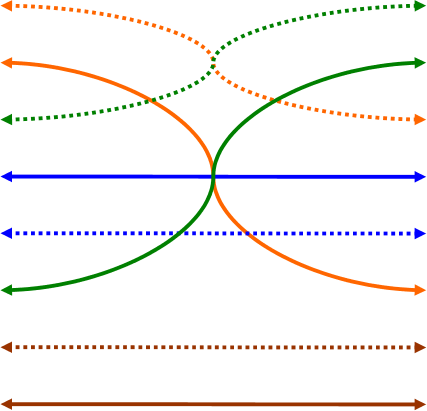

---

## Wtyki i zaciskarki

**Wtyk ekranowany** ma metalową obudowę połączoną z ekranem kabla.

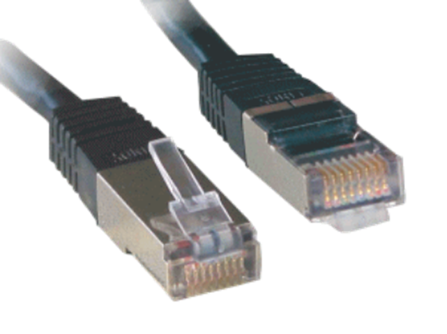

**Zaciskarka** mocuje styki wtyku na żyłach kabla. Narzędzia mogą obsługiwać także mniejsze wtyki telefoniczne.

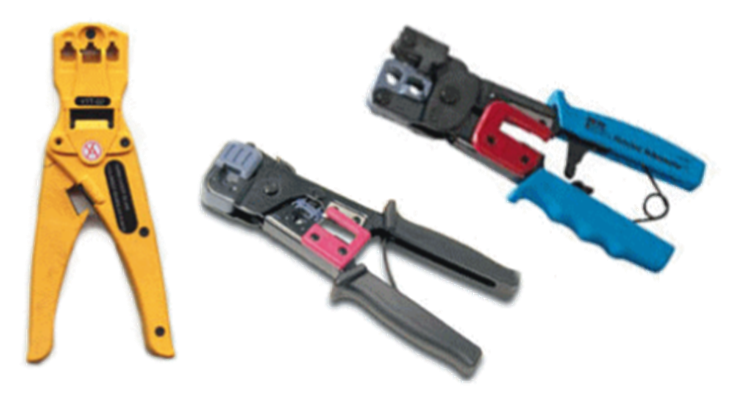

---

## Materiał: zaciskanie RJ-45

Animacja pokazuje kolejność pracy: zdjęcie powłoki, wyrównanie żył, wsunięcie ich do wtyku i zaciśnięcie styków.

<video controls preload="metadata" poster="media/image30.png"><source src="media/slide-036-media4.mp4" type="video/mp4"></video>

---

## Jak sprawdzić skrętkę po zaciśnięciu?

Dla kabla prostego tester powinien pokazać tę samą kolejność 1-8 na obu końcach. Film pokazuje też wynik dla źle połączonych żył.

<video data-youtube-fallback controls playsinline preload="metadata" poster="media/local-replacements/rj45-tester.jpg"><source src="media/local-replacements/rj45-tester.mp4" type="video/mp4"></video>

<a href="https://www.youtube.com/watch?v=QMpWkkqX1eM&amp;t=264s" target="_blank" rel="noopener noreferrer">Obejrzyj oryginał na YouTube</a>

Switched On Network · How to Crimp Cat5 / Cat6 Network Patch Cables · 04:24-05:00 · po angielsku

Prosty tester sprawdza ciągłość i kolejność połączeń pinów. Nie potwierdza kategorii ani przepustowości kabla.

---

## Tester skrętki: trzy rodzaje usterek

Tester sygnalizuje usterkę osobną kontrolką: <strong>Miswire</strong> to żyła na niewłaściwym pinie, <strong>Open</strong> to przerwa, a <strong>Short</strong> to zwarcie.

<video data-youtube-fallback controls playsinline preload="metadata" poster="media/local-replacements/rj45-faults.jpg"><source src="media/local-replacements/rj45-faults.mp4" type="video/mp4"></video>

<a href="https://www.youtube.com/watch?v=blj04uc38nI&amp;t=24s" target="_blank" rel="noopener noreferrer">Obejrzyj oryginał na YouTube</a>

Klein Tools · LAN Explorer · 00:24-01:25 · po angielsku

---

## Token Ring

- IEEE 802.5, *Token Ring Access Method*.
- Złącze IBM było hermafrodytyczne: dwa jednakowe końce można było połączyć i zablokować klipsem.
- Większe gabaryty niż w przypadku RJ-45 ograniczały liczbę portów w panelu krosowym, a złożona konstrukcja podnosiła koszt złącza.

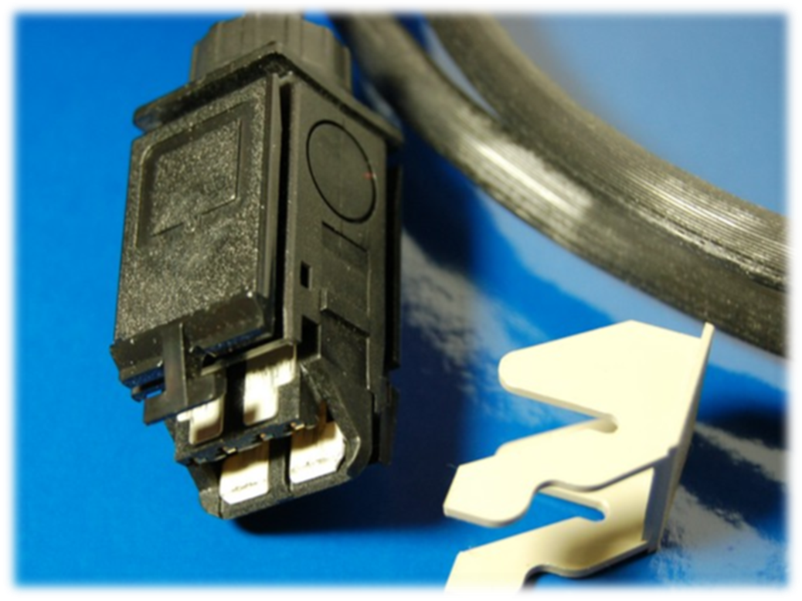
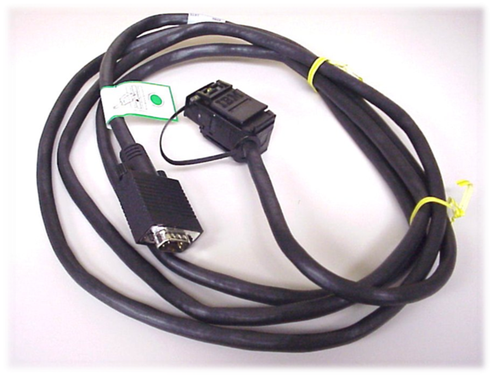

---

## Podsumowanie

- Koncentryk jest odpornym, ale historycznym medium sieciowym.
- Skrętka dominuje w sieciach LAN dzięki cenie, łatwości instalacji i różnym wariantom ekranowania.
- RJ-45 pozostaje podstawowym złączem Ethernetu w okablowaniu miedzianym.
