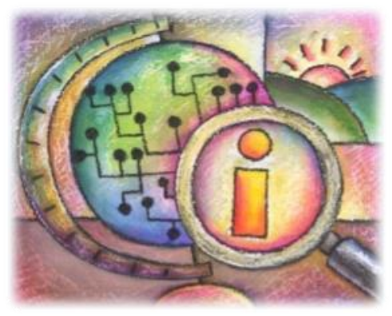
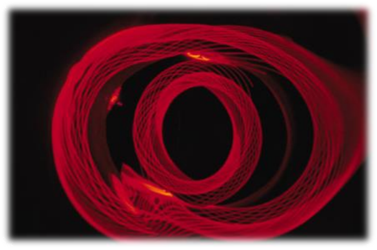
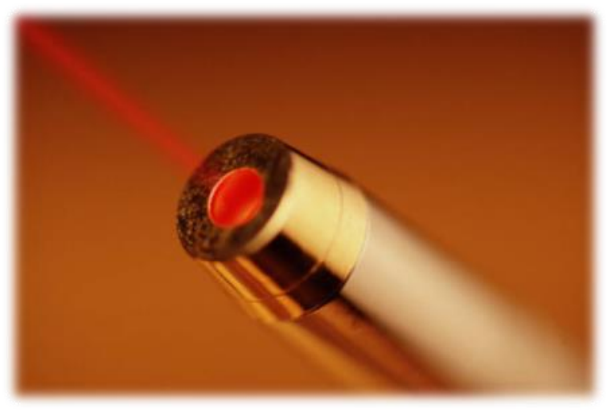
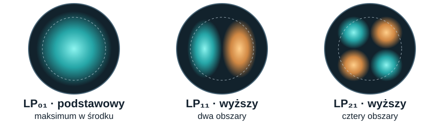
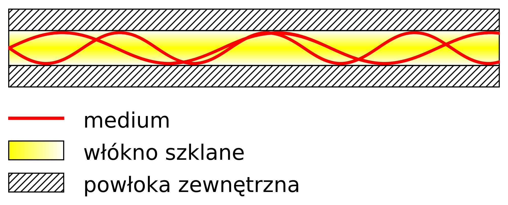
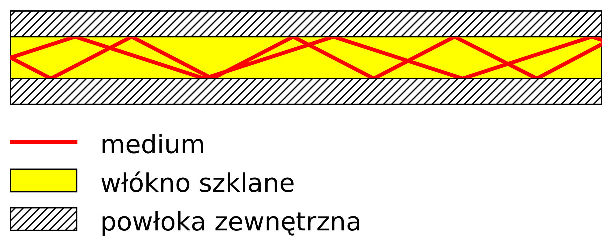

<!-- .slide: class="title-slide" -->

# Media transmisyjne: światłowody

Mikołaj Leszczuk

---

## Plan wykładu

- czym jest światłowód,
- zalety transmisji optycznej,
- światłowody jedno- i wielomodowe,
- tłumienie, zgięcia i dyspersja.

---

<!-- .slide: class="section-slide" -->

# Światłowód

---

## Co to jest światłowód?

  Powłoka ochronnaPłaszczRdzeń

Światłowód jest **falowodem optycznym**: prowadzi światło wzdłuż rdzenia włókna.

Informacja jest kodowana jako modulowana wiązka światła, zwykle pochodząca z lasera albo diody LED (*light-emitting diode*, dioda elektroluminescencyjna).

---

## Od włókna do kabla światłowodowego

Przekrój pokazuje, jak włókna są pogrupowane w tubach i chronione przez pancerz oraz zewnętrzną powłokę kabla.

<video controls preload="metadata"><source src="media/slide-052-media11.mp4" type="video/mp4"></video>

---

## Dlaczego transmisja optyczna?

- bardzo duża przepustowość,
- małe tłumienie na dużych odległościach,
- odporność na zakłócenia elektromagnetyczne: sygnał przenosi światło, a nie prąd w przewodzie,
- brak emisji elektromagnetycznej,
- małe rozmiary i masa kabla.

---

## Ewolucja światłowodów

Wczesne próby prowadzenia promieniowania podczerwonego wykorzystywały metalowe rurki o wypolerowanych ściankach. Współczesne światłowody to dielektryczne włókna, najczęściej szklane, z warstwami ochronnymi.

Włókno prowadzi światło dlatego, że współczynnik załamania płaszcza jest mniejszy niż współczynnik załamania rdzenia.

---

## Laser jako źródło światła

Laser może dostarczyć intensywną, łatwą do modulowania wiązkę światła. W światłowodzie sygnał pozostaje prowadzony przez rdzeń dzięki całkowitemu wewnętrznemu odbiciu.

---

## Wewnątrz nadajnika laserowego

Soczewka skupia wiązkę kierowaną do włókna, a fotodioda wewnątrz obudowy monitoruje moc lasera.

<video controls preload="metadata"><source src="media/slide-009-media2.mp4" type="video/mp4"></video>

---

## Długości fal w nadajnikach optycznych

Animacja pokazuje, jak odczytać długość fali z rysunku, i porównuje przykładowe długości fal emitowanych przez diody LED i diody laserowe.

<video controls preload="metadata"><source src="media/slide-007-media1.mp4" type="video/mp4"></video>

---

## Tłumienie i stopa błędów

- Dla typowego włókna jednomodowego przy długości fali około 1550 nm tłumienie może wynosić około **0,2 dB/km**. Nie jest to wartość stała dla każdego włókna i każdej długości fali.
- Niska stopa błędów zależy także od nadajnika, odbiornika, połączeń i zapasu mocy całego toru.

---

## Zasięg i trwałość łącza optycznego

- Małe tłumienie pozwala budować odcinki bez wzmacniacza liczące dziesiątki kilometrów; w starszych przykładach podawano **80–100 km**. Rzeczywisty zasięg zależy od włókna, długości fali, nadajnika i budżetu mocy.
- Przykładowa zakładana trwałość kabla to **25 lat**. Rzeczywista trwałość zależy od konstrukcji, środowiska i sposobu instalacji.

---

## Wzmacniacze w łączu światłowodowym

Na schemacie kilka kanałów biegnie jednym włóknem. Wzmacniacze po drodze kompensują spadek mocy sygnału.

<video controls preload="metadata"><source src="media/slide-012-media3.mp4" type="video/mp4"></video>

Wzmacniacz półprzewodnikowy (SOA) wzmacnia sygnał bez zamiany na elektryczny, wbrew opisowi w filmie.

<!-- study-only:start -->

---

## Wiele kanałów w jednym włóknie

Jedno włókno może przenosić wiele kanałów i usług, a sygnał optyczny można wzmacniać.

<!-- study-only:end -->

---

<!-- .slide: class="section-slide" -->

# Mody propagacji

---

## Co to jest mod światłowodu?

**Mod** to sposób rozchodzenia się fali wzdłuż włókna, z charakterystycznym rozkładem pola w jego przekroju.

Jaśniejszy kolor oznacza większą amplitudę pola. Turkusowy i pomarańczowy oznaczają przeciwne fazy; kreskowany okrąg wyznacza rdzeń. To schemat pola, nie tory promieni.

Przy danej długości fali włókno jednomodowe prowadzi tylko mod podstawowy. We włóknie wielomodowym różne mody mogą docierać do końca w różnym czasie.

---

## Podział światłowodów

**Wielomodowe (MMF, *multimode fiber*)**

Prowadzi wiele modów przestrzennych. Typowe dla krótszych odcinków i sieci lokalnych.
W omawianych przykładach średnica rdzenia wynosi **50 lub 62,5 µm**.

**Jednomodowe (SMF, *single-mode fiber*)**

Brak dyspersji międzymodowej sprzyja zastosowaniu w łączach dalekiego zasięgu i sieciach szkieletowych. Typowym źródłem światła jest laser.
Średnica rdzenia jest znacznie mniejsza, w przybliżeniu **5–10 µm**.

---

## Przekrój włókna wielomodowego

Animacja pokazuje włókno z boku i od czoła. Rozróżnia szklany rdzeń i płaszcz od polimerowych warstw ochronnych.

<video controls preload="metadata"><source src="media/slide-021-media4.mp4" type="video/mp4"></video>

---

## Przekrój włókna jednomodowego

W pokazanych włóknach jedno- i wielomodowym płaszcz ma tę samą średnicę, ale włókno jednomodowe ma znacznie cieńszy rdzeń.

<video controls preload="metadata"><source src="media/slide-025-media5.mp4" type="video/mp4"></video>

---

## Wielomodowe: gradientowe i skokowe

**Gradientowe**

Współczynnik załamania zmienia się stopniowo, co ogranicza różnice czasu przejścia modów.

**Skokowe**

Współczynnik zmienia się skokowo na granicy rdzenia i płaszcza; różne drogi mają wyraźnie różną długość.

---

## Dlaczego profil gradientowy pomaga?

- Rdzeń ma warstwy o różnym domieszkowaniu: współczynnik załamania jest największy przy osi i maleje ku płaszczowi.
- Promień biegnący dalej od osi pokonuje dłuższą drogę, ale w obszarze o mniejszym współczynniku załamania rozchodzi się szybciej.
- Czasy przejścia różnych modów stają się do siebie bardziej zbliżone, co ogranicza dyspersję międzymodową.

---

## Bieg promieni: włókno gradientowe

---

## Dlaczego profil skokowy rozmywa impuls?

W rdzeniu skokowym promienie wprowadzone pod różnymi kątami odbijają się na granicy rdzenia i płaszcza. W tym samym materiale poruszają się z podobną prędkością, lecz pokonują różne długości drogi.

Docierają więc do końca włókna w różnym czasie. Szerszy impuls wymaga większego odstępu od następnego, co ogranicza przepływność i zasięg łącza.

---

## Bieg promieni: włókno skokowe

---

<!-- .slide: class="section-slide" -->

# Straty i tłumienie

---

## Tłumienie sygnału

Tłumienie określa, o ile maleje moc optyczna sygnału podczas propagacji. W praktyce liczą się między innymi:

- absorpcja w materiale,
- rozpraszanie,
- niedoskonałości włókna,
- zgięcia i połączenia.

---

## Straty materiałowe

Szkło kwarcowe (`SiO₂`) nie jest idealnie jednorodne. Fluktuacje gęstości i współczynnika załamania rozpraszają światło, a domieszki mogą je pochłaniać.

Są to **rozpraszanie Rayleigha** i **absorpcja**. Oba mechanizmy zależą od długości fali.

---

## Zanieczyszczenia i okna transmisyjne

Zanieczyszczenia metalami, m.in. żelazem, miedzią i chromem, oraz grupy `OH⁻` zwiększają absorpcję. Jej wartość zależy od rodzaju i stężenia domieszek.

Typowe okna transmisyjne leżą w pobliżu **850 nm**, **1310 nm** i **1550 nm**. Dobór okna uwzględnia zarówno tłumienie, jak i dyspersję oraz dostępne źródła światła.

---

## Absorpcja światła w szkle

Film pokazuje jeden z mechanizmów tłumienia: domieszki w szkle pochłaniają część energii światła, która zamienia się w ciepło.

<video controls preload="metadata"><source src="media/slide-039-media9.mp4" type="video/mp4"></video>

---

## Rozpraszanie Rayleigha: przykład

Przykładowe wartości tłumienia wskutek rozpraszania w czystym szkle kwarcowym:

| Długość fali | 850 nm | 1300 nm | 1550 nm |
| --- | ---: | ---: | ---: |
| Tłumienie Rayleigha | 1,53 dB/km | 0,28 dB/km | 0,138 dB/km |

Są to wartości **samego rozpraszania**, a nie pełne tłumienie dowolnego rzeczywistego kabla. Absorpcja i niedoskonałości zwiększają straty.

---

## Straty falowodowe

Źródłem strat są odstępstwa od idealnej geometrii włókna:

- zmiany średnicy rdzenia,
- nierównomierny rozkład współczynnika załamania,
- lokalne deformacje i zgięcia włókna.

Szczególnie ważne są mikro- i makro-zgięcia.

---

## Mikro-zgięcia

- Niewielkie, miejscowe odkształcenia włókna.
- Mogą wynikać z nacisku, naprężeń i niedoskonałości konstrukcji kabla.
- Powodują mieszanie modów i ucieczkę części światła do płaszcza, czyli dodatkową utratę mocy.
- We włóknie jednomodowym zaburzają rozkład pola modu podstawowego i również mogą zwiększać tłumienie.

---

## Mikrozgięcia: straty pod naciskiem

W powiększeniu widać odkształcenia, które mogą powstać podczas produkcji włókna lub montażu. Wykres pokazuje ich wpływ na moc sygnału.

<video controls preload="metadata"><source src="media/slide-033-media7.mp4" type="video/mp4"></video>

<!-- study-only:start -->

---

## Makro-zgięcia

- Widoczne zgięcia kabla o zbyt małym promieniu.
- Część światła przestaje spełniać warunek całkowitego wewnętrznego odbicia i ucieka z rdzenia.

<!-- study-only:end -->

---

## Jak ciasno można zgiąć kabel?

Film pokazuje, gdzie mierzy się promień zgięcia. Dopuszczalne minimum dla konkretnego kabla podaje jego producent.

<video controls preload="metadata"><source src="media/slide-031-media6.mp4" type="video/mp4"></video>

---

## Makrozgięcia: straty na ciasnych łukach

Animacja pokazuje, gdzie światło ucieka z ciasno zgiętego włókna. Na wykresie odpowiadają temu miejscowe spadki mocy.

<video controls preload="metadata"><source src="media/slide-035-media8.mp4" type="video/mp4"></video>

---

## Inne przyczyny strat

- straty na złączach i spawach, zwłaszcza przy przesunięciu osi, rozsunięciu lub kątowym niedopasowaniu czół włókien,
- niewłaściwy montaż,
- starzenie materiału i wpływ środowiska.

---

<!-- .slide: class="section-slide" -->

# Dyspersja

---

## Czym jest dyspersja?

Dyspersja rozszerza impuls w czasie. Gdy sąsiednie impulsy zaczynają się nakładać, rośnie ryzyko błędnej interpretacji danych.

---

## Typy dyspersji

**Międzymodowa**

Różne mody w światłowodzie wielomodowym przemierzają różne drogi i docierają w różnym czasie.

**Chromatyczna**

Różne długości fali poruszają się z różną prędkością; obejmuje dyspersję materiałową i falowodową.

---

## Dyspersja międzymodowa

Poszerzenie impulsu rośnie z długością włókna, więc użyteczne pasmo maleje.

Rozmyty impuls może mieć niższą amplitudę szczytową nawet bez dodatkowej utraty mocy wskutek tłumienia.

---

## Dyspersja chromatyczna

- **Materiałowa:** współczynnik załamania zależy od długości fali.
- **Falowodowa:** właściwości propagacji wynikają także z geometrii rdzenia i płaszcza.
- Obie ograniczają maksymalną odległość i przepływność łącza.
- Występuje zarówno we włóknach jednomodowych, jak i wielomodowych; w tych drugich dochodzi także dyspersja międzymodowa.

---

## Dyspersja chromatyczna a błędy transmisji

Składowe impulsu o różnych długościach fal docierają w różnym czasie. Film pokazuje, jak poszerzone impulsy mogą zacząć na siebie nachodzić.

<video controls preload="metadata"><source src="media/slide-051-media10.mp4" type="video/mp4"></video>

---

## Dyspersja materiałowa

W typowym włóknie krzemionkowym dyspersja materiałowa jest niewielka w okolicy **1300 nm**. Przy ocenie całkowitej dyspersji chromatycznej trzeba uwzględnić także wkład falowodowy.

---

## Dlaczego zmieniano długość fali?

Pierwsze systemy pracowały w okolicy **830–900 nm**. Przejście w okolice **1300 nm** ograniczało dyspersję materiałową, a rozwój produkcji włókien zmniejszał tam tłumienie. Później zaczęto szeroko wykorzystywać okolice **1550 nm**, gdzie tłumienie szkła kwarcowego jest bardzo małe.

Przykładowe tłumienie dawnych włókien wynosiło około **3–5 dB/km** przy 850 nm, **0,5–1 dB/km** przy 1300 nm i **0,2 dB/km** przy 1550 nm. To przykłady historycznych włókien, a nie parametry gwarantowane dla każdego współczesnego łącza.

---

## Dyspersja falowodowa

Część pola optycznego propaguje także w płaszczu. Udział tej części zmienia się z długością fali, dlatego geometria rdzenia i płaszcza wpływa na opóźnienie składowych impulsu.

Dyspersję chromatyczną można modyfikować przez konstrukcję włókna; w praktyce rozpatruje się sumę wkładów materiałowego i falowodowego.

---

## Podsumowanie

- Światłowód daje dużą przepustowość i odporność na zakłócenia.
- Wybór włókna jedno- albo wielomodowego jest związany z odległością i wymaganiami łącza.
- Tłumienie i dyspersja są podstawowymi ograniczeniami transmisji optycznej.
