<!-- .slide: class="title-slide" -->

# Media transmisyjne: transmisja bezprzewodowa

Mikołaj Leszczuk

---

## Plan wykładu

- sieci bezprzewodowe i ich infrastruktura,
- PAN, WLAN, MAN oraz IoT,
- Wi-Fi i rodzina IEEE 802.11,
- WiMAX, LoRa i przyszłość standardów.

---

<!-- .slide: class="section-slide" -->

# Sieci bezprzewodowe

---

## Definicja

Bezprzewodowa sieć komputerowa przesyła dane przez fale radiowe lub inne medium bezprzewodowe, zamiast przez przewody między wszystkimi węzłami.

---

## WLAN

WLAN (*Wireless Local Area Network*) to bezprzewodowa sieć lokalna. Najczęściej buduje się ją w technologii Wi-Fi, opartej na standardach IEEE 802.11.

---

## Przykładowa infrastruktura WLAN

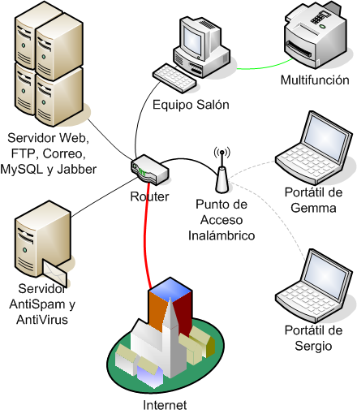

---

## Urządzenia infrastruktury

- karta sieciowa lub moduł radiowy,
- punkt dostępowy albo router,
- antena wewnętrzna lub zewnętrzna,
- kontroler zarządzający punktami dostępowymi w większej sieci,
- łącze przewodowe do sieci szkieletowej.

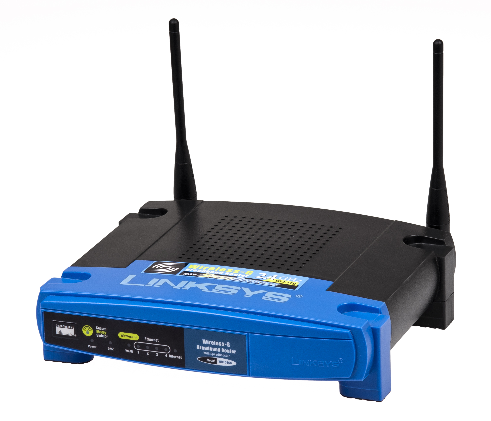

---

## Karty, anteny i osprzęt

Karta radiowa może być wbudowana w urządzenie albo podłączona zewnętrznie, np. przez USB. Starsze komputery wykorzystywały także karty PCI i PCMCIA.

Punkt dostępowy współpracuje z anteną, a instalacja może wymagać kabli antenowych, złączy, przejściówek lub rozdzielaczy. Te elementy nie są medium między stacjami, ale nadal należą do infrastruktury sieci bezprzewodowej.

---

## Materiał wideo: czym jest WLAN?

Na przykładzie laptopa i domowego rutera film pokazuje, jak ruter tworzy bezprzewodową sieć lokalną i może przez nią udostępniać Internet.

<video controls preload="metadata"><source src="media/videos/DAR52r0lEtw.mp4" type="video/mp4"></video>

---

## Zalety i ograniczenia

**Zalety**

- mobilność,
- szybkie wdrożenie,
- łatwa rozbudowa,
- dostęp w miejscach trudnych dla kabli.

**Ograniczenia**

- współdzielone widmo,
- zakłócenia i tłumienie,
- zasięg zależny od otoczenia,
- konieczność właściwego zabezpieczenia.

---

## Typy sieci

  
<strong>PAN</strong> osobista

  
<strong>LAN / WLAN</strong> lokalna

  
<strong>MAN</strong> miejska

  
<strong>WAN</strong> rozległa

PAN: <em>Personal Area Network</em>; LAN: <em>Local Area Network</em>; WLAN: <em>Wireless LAN</em>; MAN: <em>Metropolitan Area Network</em>; WAN: <em>Wide Area Network</em>.

---

## Zakresy sieci - szersza perspektywa

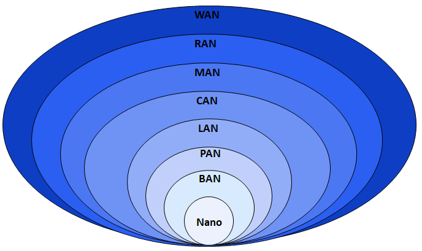

---

## Materiał wideo: rodzaje sieci

Animacja porównuje zasięg sieci od urządzeń osobistych po sieci rozległe. Pokazuje też sieć kampusową i sieć pamięci masowej.

<video controls preload="metadata"><source src="media/videos/4_zSIXb7tLQ.mp4" type="video/mp4"></video>

---

## PAN i Internet rzeczy (IoT)

IoT (*Internet of Things*) to sieć połączonych czujników i urządzeń wykonujących zadania bez stałej obsługi człowieka.

- **Bluetooth:** połączenia osobiste, urządzenia peryferyjne i audio.
- **Zigbee:** protokół dla energooszczędnych czujników i automatyki, oparty na radiu IEEE 802.15.4. IEEE to *Institute of Electrical and Electronics Engineers*.
- **Z-Wave:** domowa automatyka.
- **Thread:** łączy urządzenia IoT z użyciem IPv6 (*Internet Protocol version 6*).

---

## Moduły małej mocy dla IoT

Niewielki moduł radiowy może być częścią czujnika, sterownika lub urządzenia noszonego. W takich zastosowaniach ważniejsze od wysokiej przepływności bywają zasięg i zużycie energii.

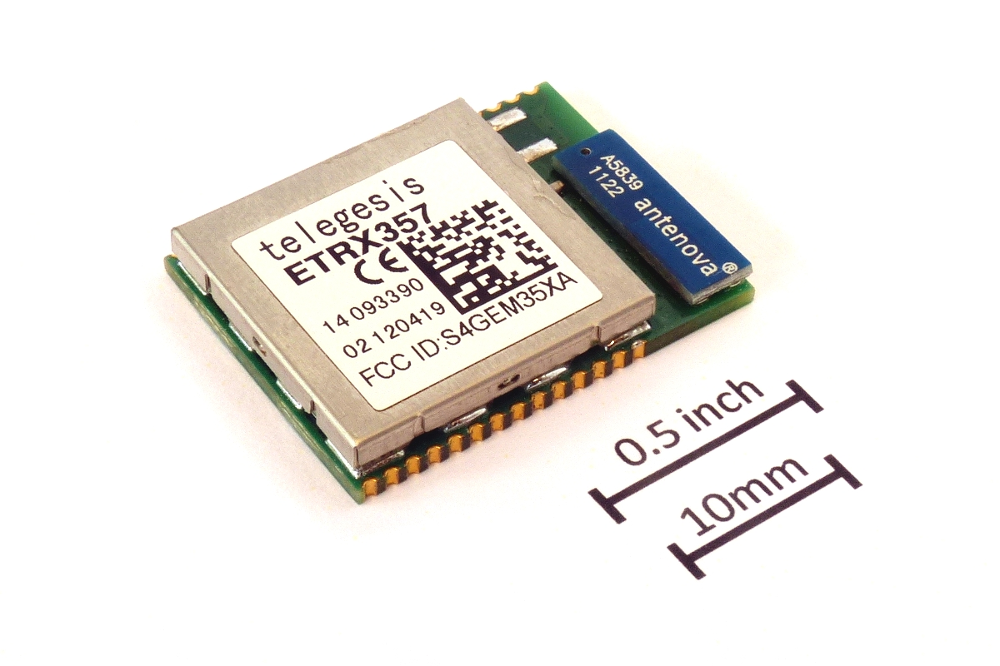

---

## Sieć czujników noszonych na ciele

Na przykładzie czujników noszonych na ciele film pokazuje, jak dane trafiają do urządzenia zbierającego, np. w monitorowaniu zdrowia.

<video controls preload="metadata"><source src="media/videos/iw9pQeFhN74.mp4" type="video/mp4"></video>

---

## Wi-Fi a IEEE 802.15.4

Film porównuje Wi-Fi z radiem IEEE 802.15.4. Zigbee i Thread używają tego samego standardu radiowego, ale mają różne stosy sieciowe. Podane 54 Mb/s nie jest limitem Wi-Fi.

<video controls preload="metadata"><source src="media/videos/buV11ZPJ7MQ.mp4" type="video/mp4"></video>

---

## Bluetooth i Z-Wave

  
  

---

## Osobiste sieci radiowe: kontekst historyczny

- Wczesny Bluetooth pracował w paśmie 2,4 GHz i oferował do około 723 kb/s w jednym kierunku. Nowsze odmiany mają inne szybkości i zastosowania.
- Z-Wave rozwijał automatykę domową jako sieć o małej mocy, z możliwością przekazywania komunikatów między urządzeniami.
- Thread wykorzystuje radio IEEE 802.15.4; uwierzytelnianie i szyfrowanie są częścią jego projektu.

---

## Materiał wideo: Z-Wave

Film pokazuje zastosowania Z-Wave w domu, m.in. do obsługi zamków, oświetlenia i termostatów.

<video controls preload="metadata"><source src="media/videos/vhzLYmiwNTk.mp4" type="video/mp4"></video>

---

## Materiał wideo: Thread

Film pokazuje, jak urządzenia Thread tworzą domową sieć kratową i przekazują dane przez inne węzły.

<video controls preload="metadata"><source src="media/videos/KElUxj12IIY.mp4" type="video/mp4"></video>

---

<!-- .slide: class="section-slide" -->

# IEEE 802.11 i Wi-Fi

---

## Pasma Wi-Fi

**2,4 GHz**

Dobry zasięg, duże zatłoczenie, szeroka zgodność urządzeń.

**5 GHz i 6 GHz**

Więcej kanałów i większa przepływność; zwykle krótszy zasięg.

**Wi-Fi 6E** to Wi-Fi 6 z obsługą pasma 6 GHz. W UE dla radiowych sieci lokalnych zharmonizowano zakres [5945-6425 MHz](https://eur-lex.europa.eu/legal-content/EN/TXT/?uri=CELEX%3A02021D1067-20250522).

---

## Kanały w paśmie 2,4 GHz

Kanały 20 MHz częściowo się nakładają. Typowy zestaw bez nakładania: **1, 6, 11**.

Dostępność kanałów zależy od przepisów danego kraju.

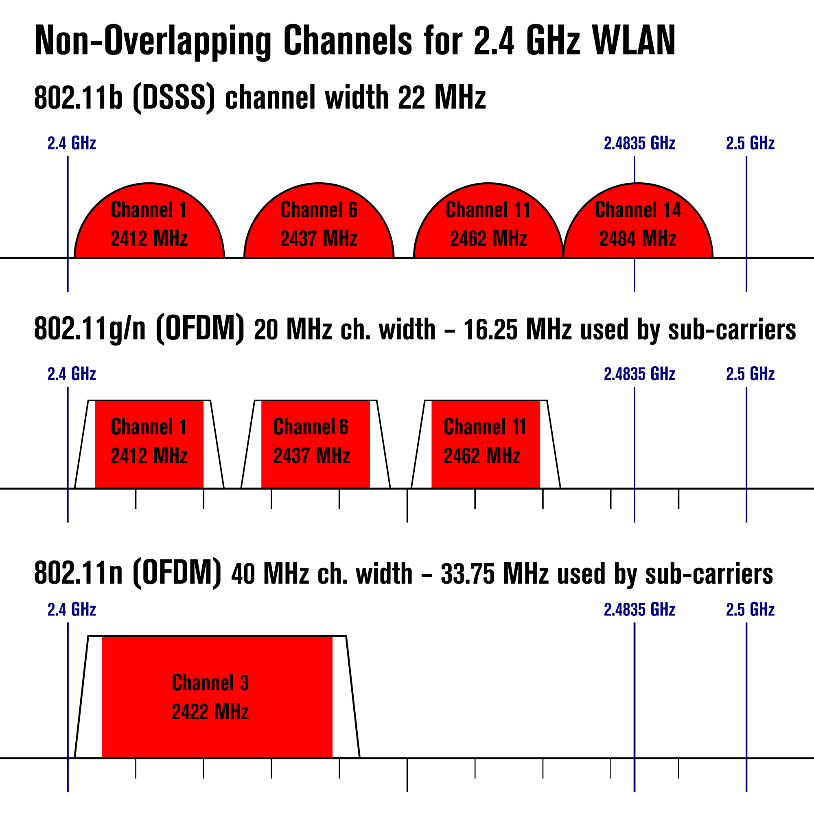

---

## Sprzęt Wi-Fi - dawniej i dziś

  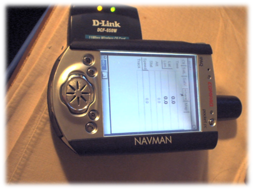
  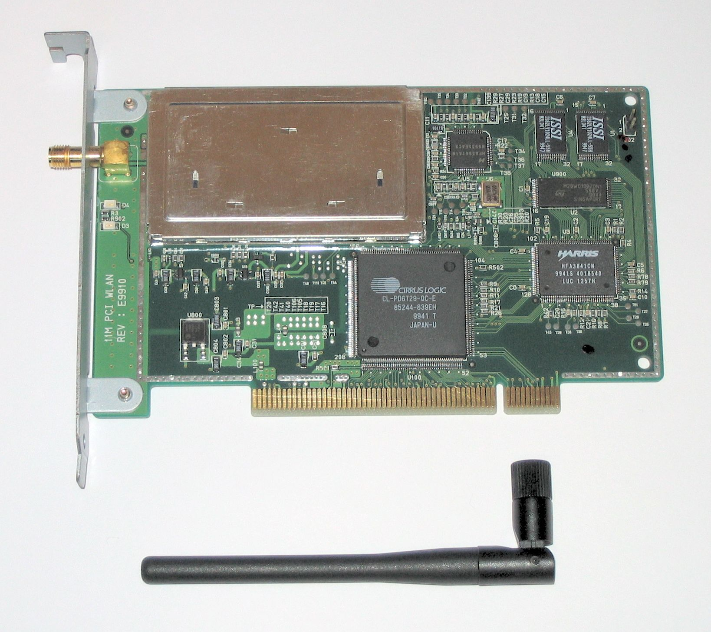
  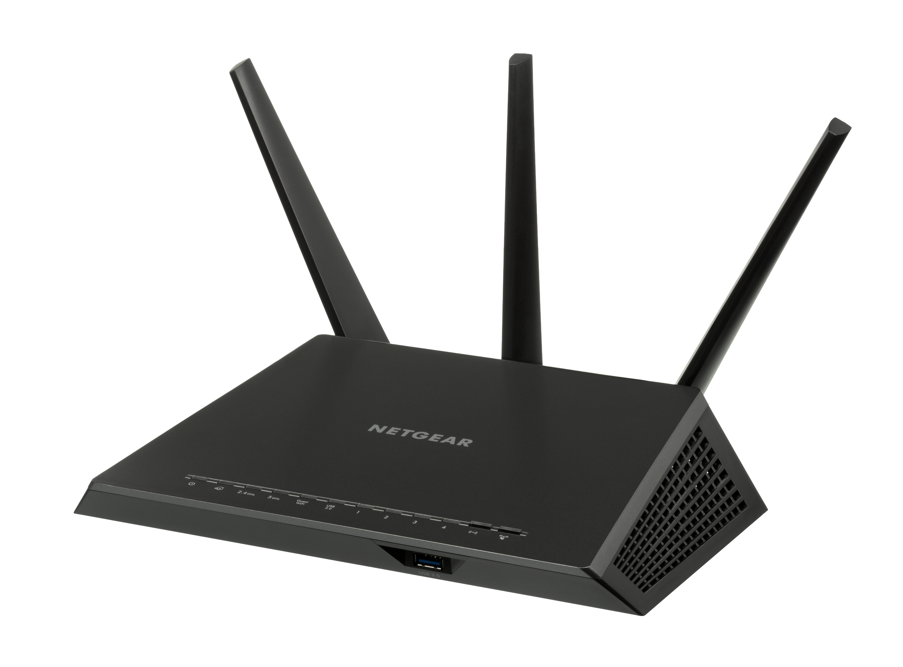

---
## Rozwój Wi-Fi

  
2 Mb/s<strong>802.11</strong>1997

  
11 Mb/s<strong>Wi-Fi 1</strong>1999

  
54 Mb/s<strong>Wi-Fi 2</strong>1999

  
54 Mb/s<strong>Wi-Fi 3</strong>2003

  
600 Mb/s<strong>Wi-Fi 4</strong>2009

  
6,93 Gb/s<strong>Wi-Fi 5</strong>2013

  
9,61 Gb/s<strong>Wi-Fi 6 / 6E</strong>2021

  
23,1 Gb/s<strong>Wi-Fi 7</strong>2024

<strong>P802.11bn - projekt IEEE</strong>Nacisk na niezawodność. Projektu nie porównujemy na wykresie maksymalnych szybkości.

Maksymalna szybkość PHY (<em>physical layer</em>) jednego łącza, w skali logarytmicznej. Lata odpowiadają oznaczeniom IEEE, nie startowi certyfikacji.

---

## Wybrane standardy IEEE 802.11

  
Standard

Rok w oznaczeniu

Pasmo

Kanał

Maks. PHY

  
802.11 (pierwsza wersja)

1997

2,4 GHz / podczerwień

zależnie od wariantu

2 Mb/s

  
802.11a

1999

5 GHz

20 MHz

54 Mb/s

  
802.11b

1999

2,4 GHz

22 MHz

11 Mb/s

  
802.11g

2003

2,4 GHz

20 MHz

54 Mb/s

  
802.11n

2009

2,4 / 5 GHz

20 / 40 MHz

600 Mb/s

  
802.11ad

2012

60 GHz

2160 MHz

6,76 Gb/s

  
802.11ac

2013

5 GHz

20–160 MHz

6,93 Gb/s

  
802.11ax

2021

2,4 / 5 / 6 GHz

20–160 MHz

9,61 Gb/s

  
802.11be

2024

2,4 / 5 / 6 GHz

do 320 MHz w 6 GHz

23,1 Gb/s

Maksima PHY dla jednego łącza. Rzeczywista przepływność zależy od konfiguracji i warunków radiowych. IEEE opublikowało 802.11be-2024 w 2025 r.

---

## Starsze generacje Wi-Fi: zgodność i ograniczenia

- Wersja 802.11 z 1997 r. przewidywała zarówno radio, jak i transmisję podczerwoną; rozwój WLAN skupił się później na radiu.
- 802.11g współpracowało z urządzeniami 802.11b w paśmie 2,4 GHz, ale obecność starszych stacji mogła spowalniać sieć.
- Urządzenia 802.11a pracowały w 5 GHz i nie mogły łączyć się z urządzeniami obsługującymi wyłącznie 2,4 GHz.
- Przy słabym sygnale urządzenia mogły obniżać szybkość transmisji radiowej.

---

## Materiał wideo: 802.11b, g i n

Porównanie 802.11b, g i n pokazuje wyniki pomiaru w kilku odległościach. To wyniki tej konfiguracji, nie maksymalne szybkości standardów.

<video controls preload="metadata"><source src="media/videos/KysPKUBo1u4.mp4" type="video/mp4"></video>

---

## Producenckie rozszerzenia dawnego Wi-Fi

**802.11b+** i **Super G** to nazwy rozwiązań producentów, nie standardów IEEE. Oferowały wyższe szybkości, m.in. przez łączenie kanałów, ale nie gwarantowały współpracy urządzeń różnych firm.

---

## MIMO: wiele anten po obu stronach

MIMO (*Multiple Input Multiple Output*) może przenosić kilka strumieni równolegle, gdy pozwalają na to sprzęt i warunki radiowe.

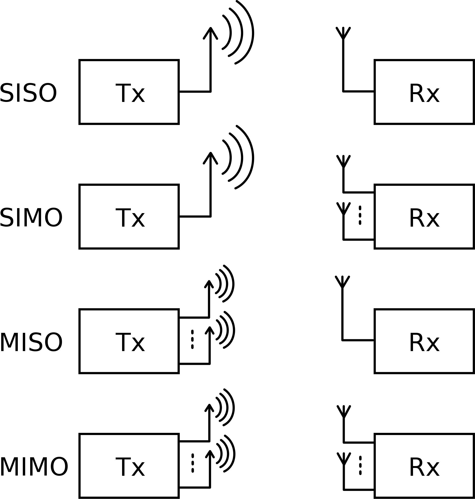

- **SISO:** jedna antena nadawcza, jedna odbiorcza.
- **SIMO:** jedna nadawcza, wiele odbiorczych.
- **MISO:** wiele nadawczych, jedna odbiorcza.
- **MIMO:** wiele nadawczych i odbiorczych.

---

## MU-MIMO w 802.11ac

MU-MIMO (<em>Multi-User MIMO</em>) rozdziela równoległe strumienie między kilku użytkowników. W 802.11ac działa w kierunku od punktu dostępowego do stacji.

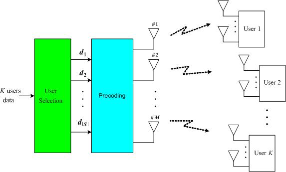

---

## Co zmieniły 802.11n, ac i ax

- **802.11n:** MIMO i kanały 20/40 MHz.
- **802.11ac:** w paśmie 5 GHz: kanały do **160 MHz**, do **ośmiu strumieni przestrzennych** i modulacja **256-QAM** (*Quadrature Amplitude Modulation*).
- **802.11ax:** OFDMA (*Orthogonal Frequency-Division Multiple Access*) i planowanie transmisji w zatłoczonych sieciach, a także **1024-QAM**. Większa przepływność wymaga odpowiednio dobrych warunków radiowych.

---

## Materiał wideo: 802.11n a 802.11ac

Animacja NETGEAR porównuje 802.11ac z wcześniejszymi generacjami i ilustruje kształtowanie wiązki w kierunku urządzeń.

<video controls preload="metadata"><source src="media/videos/DsWJ-ei5jrc.mp4" type="video/mp4"></video>

---

## Wi-Fi 6: podział kanału w OFDMA

MU-MIMO rozdziela strumienie przestrzenne. Animacja Qualcomm pokazuje drugi sposób obsługi wielu urządzeń: OFDMA przydziela im różne części pasma kanału.

<video controls preload="metadata"><source src="media/videos/HgIJmdzNyIQ.mp4" type="video/mp4"></video>

---

## Wi-Fi 7: skąd bierze się poprawa?

- **Kanał do 320 MHz** w paśmie 6 GHz mieści więcej danych, gdy dostępne jest odpowiednio szerokie pasmo.
- **4096-QAM** przenosi więcej bitów na symbol niż 1024-QAM, ale wymaga dobrego sygnału.
- **MLO** (*Multi-Link Operation*) pozwala korzystać z kilku łączy, np. w 5 i 6 GHz. Zależnie od trybu może zwiększać szybkość lub ograniczać opóźnienia.

Wi-Fi Alliance uruchomiła certyfikację w 2024 r. IEEE opublikowało 802.11be-2024 w lipcu 2025 r.

---

## 60 GHz i 802.11ad / ay

- Bardzo duża przepływność na krótkim dystansie.
- Silne tłumienie i słaba penetracja przeszkód.
- Zastosowania: łącza punkt-punkt, dokowanie bezprzewodowe, krótkodystansowe transmisje multimedialne.
- 802.11ay rozwinął 802.11ad m.in. przez łączenie kanałów i transmisję wieloantenową MIMO; osiągalny zasięg i szybkość zależą od sprzętu oraz warunków propagacji.

---

## WiGig i pasmo 60 GHz

---

## Materiał wideo: Wi-Fi przy 60 GHz

Animacja pokazuje przykładowe zastosowania WiGig (802.11ad) w paśmie 60 GHz, m.in. szybką transmisję na krótkim dystansie.

<video controls preload="metadata"><source src="media/videos/zcfuTD3z7aA.mp4" type="video/mp4"></video>

---

## 802.11ah: Wi-Fi HaLow

IEEE 802.11ah przenosi Wi-Fi do pasm **poniżej 1 GHz** (dostępne częstotliwości zależą od kraju). Niższa częstotliwość sprzyja większemu zasięgowi niż typowe pasma 2,4 i 5 GHz, kosztem mniejszej przepływności.

Standard przewidziano między innymi dla czujników i urządzeń Internetu rzeczy, w których ważne są oszczędzanie energii oraz obsługa wielu stacji.

---

## Inne rozszerzenia IEEE 802.11

- **802.11d / h / j:** dostosowanie pracy radiowej do wymagań regionalnych.
- **802.11e:** mechanizmy jakości obsługi i priorytetów ruchu.
- **802.11i:** mechanizmy bezpieczeństwa sieci WLAN.
- **802.11f:** historyczna specyfikacja współpracy punktów dostępowych.
- **802.11aj:** regionalny wariant dla pasma 45 GHz.

Są to rozszerzenia rodziny 802.11, a nie kolejne generacje oznaczane nazwami Wi-Fi 4, 5, 6 i 7.

---

## Kompatybilność i certyfikacja

- Zgodność standardu radiowego nie zawsze oznacza pełną zgodność funkcji urządzeń.
- Certyfikat Wi-Fi Alliance ułatwia przewidywalną współpracę produktów.
- Planowanie sieci wymaga doboru pasma, kanałów, mocy i zabezpieczeń.

---

## Pozostałe grupy IEEE 802

- **802.15:** bezprzewodowe sieci osobiste, w tym 802.15.4 dla urządzeń małej mocy.
- **802.16 / 802.16e:** szerokopasmowy dostęp radiowy WiMAX, także mobilny.
- **802.18:** doradztwo w sprawach regulacji radiowych.
- **802.20:** mobilny szerokopasmowy dostęp radiowy.
- **802.22:** regionalne sieci bezprzewodowe.

To historyczny przegląd rodzin standardów, nie lista technologii równie popularnych dziś.

---

<!-- .slide: class="section-slide" -->

# Sieci miejskie i dalekiego zasięgu

---

## WiMAX

- WiMAX (*Worldwide Interoperability for Microwave Access*): rodzina IEEE 802.16 dla szerokopasmowych sieci metropolitalnych.
- Przeznaczona do dostępu bezprzewodowego na większych obszarach niż WLAN.
- Historycznie ważna alternatywa dla dostępu przewodowego, obecnie wyparta w wielu zastosowaniach przez sieci komórkowe.

---

## WiMAX - infrastruktura

Stacje bazowe wykorzystują anteny sektorowe do obsługi różnych kierunków. Łącza dosyłowe łączą stacje z resztą sieci operatora.

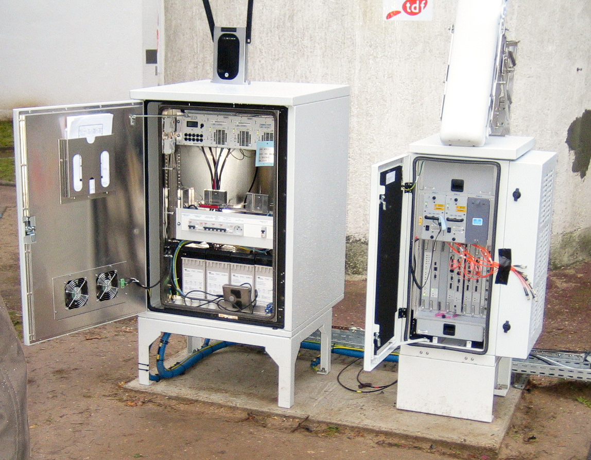

---

## Materiał wideo: WiMAX

Archiwalna animacja Intela pokazuje, jak stacje bazowe WiMAX miały zapewniać mobilny dostęp szerokopasmowy na obszarze ich pokrycia.

<video controls preload="metadata"><source src="media/videos/KQdc5AdJqCg.mp4" type="video/mp4"></video>

---

## LoRa i LoRaWAN

LoRa (*Long Range*) to technika radiowa dalekiego zasięgu, a LoRaWAN (*Long Range Wide Area Network*) określa sieciowy sposób jej użycia.

- Mała przepływność, daleki zasięg i niskie zużycie energii.
- Przeznaczone dla czujników, telemetrii i IoT.
- Wykorzystują częstotliwości poniżej 1 GHz, zależne od regionu, np. okolice 868 MHz w Europie i 915 MHz w Ameryce Północnej.

---

## LoRa: pochodzenie i pasma

LoRa opracowała firma Cycleo; w 2012 r. przejął ją Semtech.

Typowe pasma i dopuszczalna moc zależą od lokalnych przepisów. Przykładowych częstotliwości nie należy traktować jako uniwersalnych.

---

## LoRa - urządzenie i obszary zastosowań

  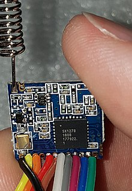
  

---

## Materiał wideo: LoRa

Animacja pokazuje, jak czujniki w budynkach i miastach mogą przekazywać dane przez wspólną infrastrukturę LoRa.

<video controls preload="metadata"><source src="media/videos/m6IvwcjcxQc.mp4" type="video/mp4"></video>

---

## Co dalej z IEEE 802?

- **Opublikowany: 802.11bf-2025.** Urządzenia WLAN mogą wykorzystywać zmiany sygnału radiowego do wykrywania zmian w otoczeniu, np. ruchu.
- **W opracowaniu: P802.11bn.** Celem jest bardziej niezawodna transmisja, m.in. mniej strat i krótsze opóźnienia w trudnych warunkach radiowych.

Stan na listopad 2026 r.: <a href="https://ieee802.org/11/overview.html">opublikowane standardy</a> i <a href="https://www.ieee802.org/11/Reports/802.11_Timelines.htm">harmonogram projektów IEEE</a>.

---

## Jak IEEE widziało rozwój sieci

W archiwalnym materiale członkowie IEEE omawiają kierunki rozwoju sieci. To perspektywa z czasu nagrania, nie aktualna lista planów.

<video controls preload="metadata"><source src="media/videos/fRnGP41TE2s.mp4" type="video/mp4"></video>

---

## Podsumowanie

- Bezprzewodowość daje mobilność, ale wymaga planowania radiowego i zabezpieczeń.
- IEEE 802.11 ewoluował od podstawowego WLAN do wielopasmowej, wysokowydajnej infrastruktury.
- PAN, WiMAX i LoRa odpowiadają na odmienne potrzeby zasięgu, energii i przepływności.
