<!-- .slide: class="title-slide" -->

# Transmisja sygnałów w systemach dostępu wielokrotnego

Mikołaj Leszczuk

---

## Plan wykładu

- kanał telekomunikacyjny i medium dzielone,
- dostęp losowy: ALOHA i szczelinowy ALOHA,
- nasłuchiwanie nośnej: CSMA,
- zapobieganie i wykrywanie kolizji: CSMA/CA oraz CSMA/CD.

---

## Medium dzielone

W medium dzielonym wiele stacji korzysta z jednego kanału transmisyjnego. Gdy dwie stacje nadają jednocześnie, ich sygnały mogą utworzyć **kolizję**.

  
Wspólny kanał radiowy

  

A
<strong>Stacja A</strong>nadaje

  

B
<strong>Stacja B</strong>odbiera kanał

  

C
<strong>Stacja C</strong>odbiera kanał

---

## Praca w medium dzielonym

  <figure>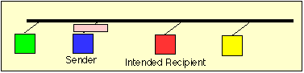<figcaption>1. Gotowość stacji</figcaption></figure>
  <figure>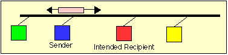<figcaption>2. Stacja A nadaje</figcaption></figure>
  <figure>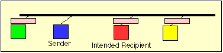<figcaption>3. Sygnał dociera do wszystkich</figcaption></figure>
  <figure>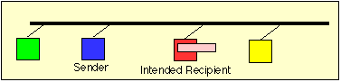<figcaption>4. Adresat przyjmuje ramkę</figcaption></figure>

---

## Kto odbiera ramkę w medium dzielonym?

W klasycznym Ethernecie na wspólnym kablu zbiór stacji, których transmisje mogą się wzajemnie zderzyć, tworzy **domenę kolizyjną**.

- Nagłówek ramki zawiera docelowy adres **MAC** (*Media Access Control*).
- Terminatory na końcach dawnej magistrali pochłaniały energię sygnału, ograniczając odbicia.

---

## Metody dostępu

**Sporne**

Stacje samodzielnie próbują uzyskać dostęp. Kolizje są możliwe, ale protokół określa reakcję.

**Kontrolowane**

Dostęp jest przydzielany według ustalonej reguły. Ogranicza to kolizje kosztem dodatkowej organizacji transmisji.

---

## Historyczne metody kontrolowane

- **Przepytywanie:** urządzenie centralne pyta stacje, czy chcą nadawać.
- **Przekazywanie znacznika:** prawo nadawania przechodzi między stacjami w magistrali albo pierścieniu.
- **Pierścień szczelinowy:** po pierścieniu krążą szczeliny gotowe na dane.
- **Wtrącany rejestr:** stacja wprowadza własne dane do obiegu pierścienia.

---

<!-- .slide: class="section-slide" -->

# ALOHA

---

## Skąd wzięło się ALOHA?

Metodę opracowano dla sieci ALOHAnet na Uniwersytecie Hawajskim. Stacje radiowe współdzieliły kanał i przesyłały dane do centralnej stacji, więc potrzebowały reguły ponawiania transmisji po kolizji.

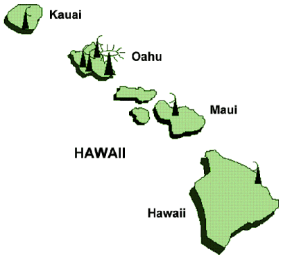

---

## Zwykłe ALOHA

- Nadaj, gdy masz dane.
- Jeżeli nie nadejdzie potwierdzenie, uznaj kolizję.
- Odczekaj losowy czas i spróbuj ponownie.

To prosty protokół, ale przy większym obciążeniu często dochodzi do kolizji.

---

## ALOHA: potwierdzenie odbioru

  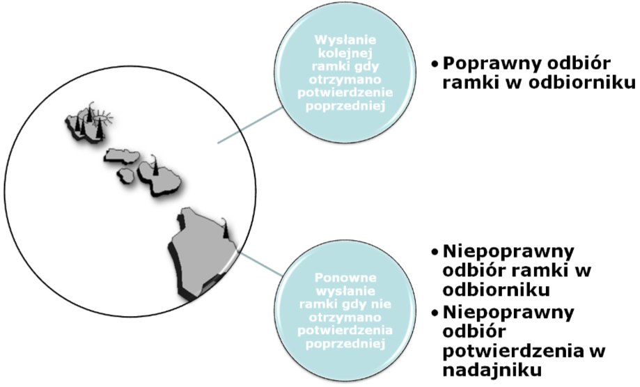

---

## ALOHA: kolizje

  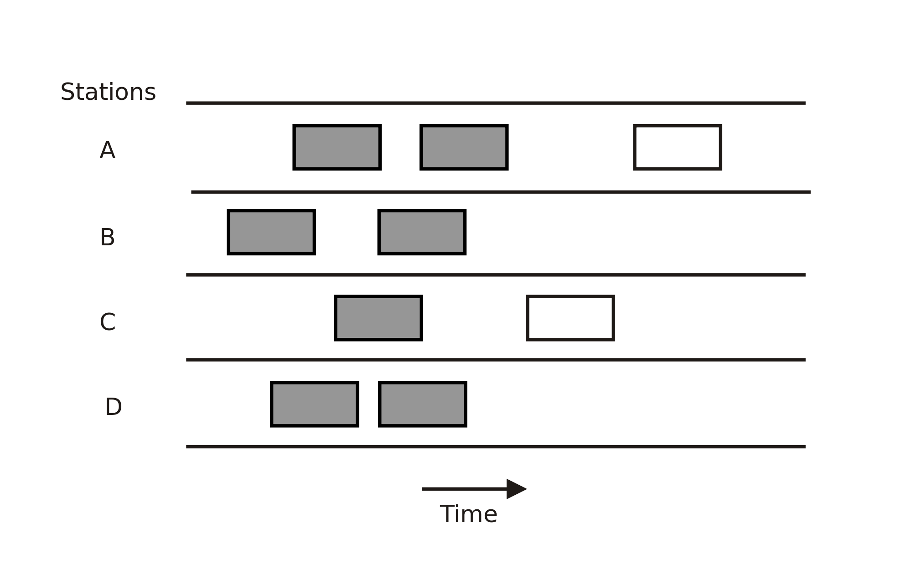

---

## ALOHA: kiedy ramki się nakładają?

Kolizja występuje, gdy ramka innej stacji rozpocznie się w takim momencie, że jej sygnał nakłada się na choćby część rozpatrywanej ramki. W zwykłym ALOHA możliwy okres kolizji jest dłuższy niż w wariancie szczelinowym.

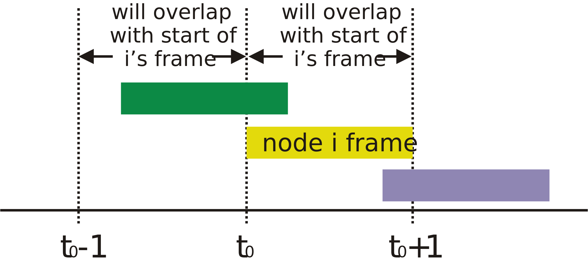

---

## Szczelinowy ALOHA

- Czas dzieli się na szczeliny.
- Stacja może rozpocząć nadawanie tylko na początku szczeliny.
- Zmniejsza to obszar, w którym transmisje mogą się nakładać, i poprawia wykorzystanie kanału.

---

## Szczelinowy ALOHA: przebieg transmisji

  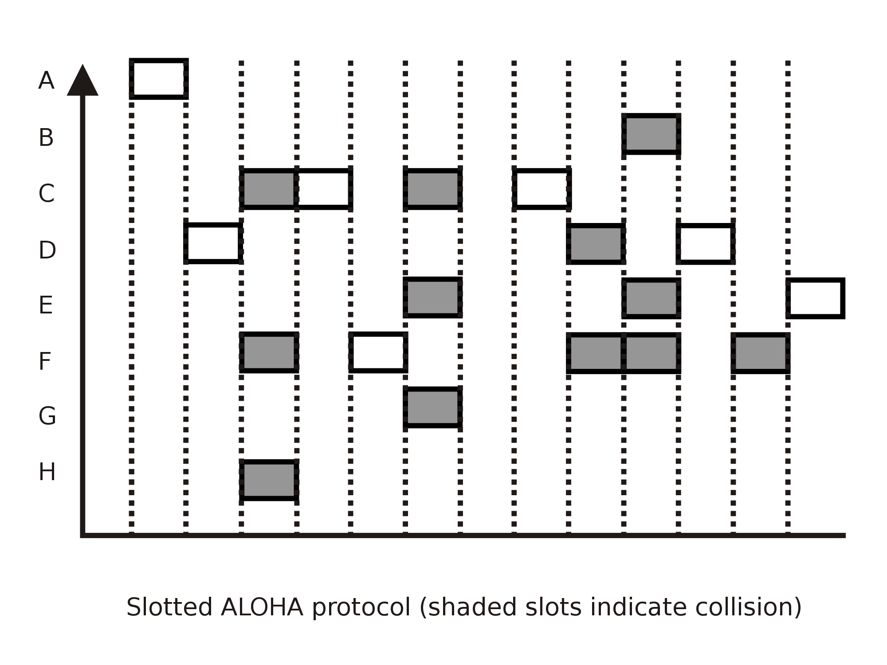

---

<!-- .slide: class="section-slide" -->

# CSMA

---

## CSMA: nasłuchiwanie nośnej

*Carrier Sense Multiple Access*:

1. stacja sprawdza, czy medium jest zajęte,
2. jeśli jest wolne, może rozpocząć nadawanie,
3. jeśli jest zajęte, czeka zgodnie z regułą protokołu.

Kolizja pozostaje możliwa z powodu opóźnienia propagacji.
Sygnał potrzebuje czasu na dotarcie do drugiego końca sieci i z powrotem; ten czas obiegu to **RTT** (*round-trip time*).

---

## Jednoczesna chęć nadawania

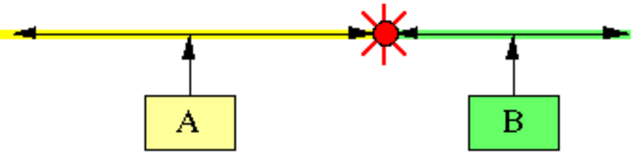

---

## Warianty CSMA

- **1-persistent:** nadaj natychmiast, gdy medium stanie się wolne.
- **non-persistent:** odczekaj losowo i sprawdź ponownie.
- **p-persistent:** w pracy szczelinowej nadaj z prawdopodobieństwem `p`.

Wybór jest kompromisem między opóźnieniem a ryzykiem kolizji.

---

<!-- .slide: class="section-slide" -->

# CSMA/CA

---

## Unikanie kolizji

W Wi-Fi trudno wykryć kolizję podczas nadawania. Film pokazuje, jak CSMA/CA (<em>Carrier Sense Multiple Access with Collision Avoidance</em>) ogranicza to ryzyko przez nasłuch i odczekanie.

<video data-youtube-fallback controls playsinline preload="metadata" poster="media/local-replacements/csma-ca.jpg"><source src="media/local-replacements/csma-ca.mp4" type="video/mp4"></video>

<a href="https://www.youtube.com/watch?v=iKn0GzF5-IU&amp;t=252s" target="_blank" rel="noopener noreferrer">Obejrzyj oryginał na YouTube</a>

PowerCert Animated Videos · CSMA/CD and CSMA/CA Explained · fragment 04:12.830–05:03.300

Opcjonalne RTS/CTS (<em>Request to Send / Clear to Send</em>) rezerwuje medium. Losowy czas oczekiwania to <em>backoff</em>; ACK to potwierdzenie odbioru.

---

## Dlaczego Wi-Fi unika kolizji?

Węzeł radiowy może nie słyszeć innego węzła, choć oba zakłócają odbiornik docelowy. To klasyczny problem **ukrytego terminala**.

  

  
A i B nie słyszą się wzajemnie

  
Punkt dostępowy

  
Stacja A

  
Stacja B

---

<!-- .slide: class="section-slide" -->

# CSMA/CD

---

## Wykrywanie kolizji

Film pokazuje, jak CSMA/CD (<em>Carrier Sense Multiple Access with Collision Detection</em>) wykrywa kolizję na wspólnym łączu Ethernet i ponawia transmisję po odczekaniu.

<video data-youtube-fallback controls playsinline preload="metadata" poster="media/local-replacements/csma-cd.jpg"><source src="media/local-replacements/csma-cd.mp4" type="video/mp4"></video>

<a href="https://www.youtube.com/watch?v=iKn0GzF5-IU&amp;t=38s" target="_blank" rel="noopener noreferrer">Obejrzyj oryginał na YouTube</a>

PowerCert Animated Videos · CSMA/CD and CSMA/CA Explained · fragment 00:38.260–03:40.700

Brak wykrytej kolizji nie gwarantuje dostarczenia ramki. CSMA/CD dotyczy medium współdzielonego i pracy półdupleksowej. Dzisiejszy Ethernet przełączany zwykle pracuje w pełnym dupleksie.

<!-- study-only:start -->

---

## Przebieg kolizji w CSMA/CD

W klasycznym Ethernecie współdzielonym stacja monitoruje medium również podczas własnego nadawania. Po wykryciu kolizji przerywa ramkę i wysyła **jam sequence**, aby inne stacje także rozpoznały kolizję.

Nadawcy ponawiają próbę po losowym czasie.

<!-- study-only:end -->

---

## Sekwencja zagłuszająca i kontrola ramki

W przykładzie sekwencja zagłuszająca ma **32 bity**. Uszkodzona ramka zostaje odrzucona, bo nie przechodzi kontroli FCS/CRC.

---

## Kolizja w CSMA/CD: propagacja

  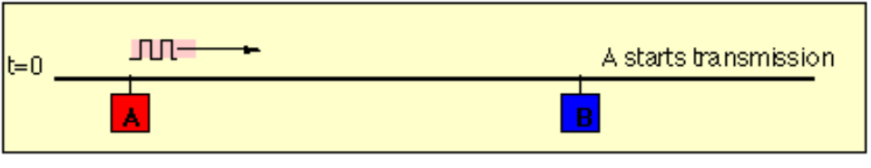
  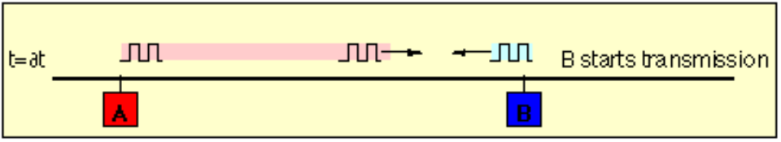

---

## Kolizja w CSMA/CD: wykrycie

  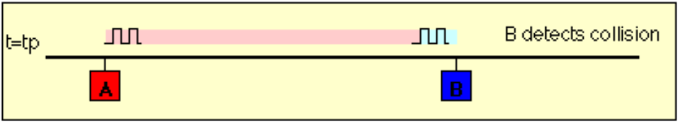
  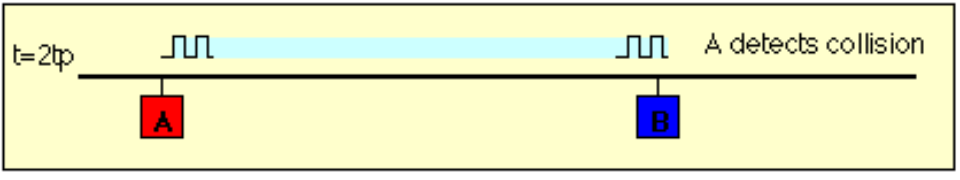

---

## Minimalny rozmiar ramki

Nadawca musi jeszcze transmitować, kiedy ewentualny sygnał kolizji zdąży do niego wrócić z najdalszego punktu sieci. Z tego wynika minimalny rozmiar ramki Ethernetu.

W klasycznym Ethernecie ramka ma co najmniej **64 bajty** od adresu docelowego do FCS, a pole danych co najmniej **46 bajtów**. Limit zasięgu segmentu i liczba wzmacniaczy wynikają z czasu propagacji w obie strony.

<!-- study-only:start -->

---

## CSMA/CD a pełny dupleks

W pełnym dupleksie oba końce mogą nadawać równocześnie bez kolizji, więc CSMA/CD nie jest potrzebne.

---

## CSMA/CD: decyzja po kolizji

  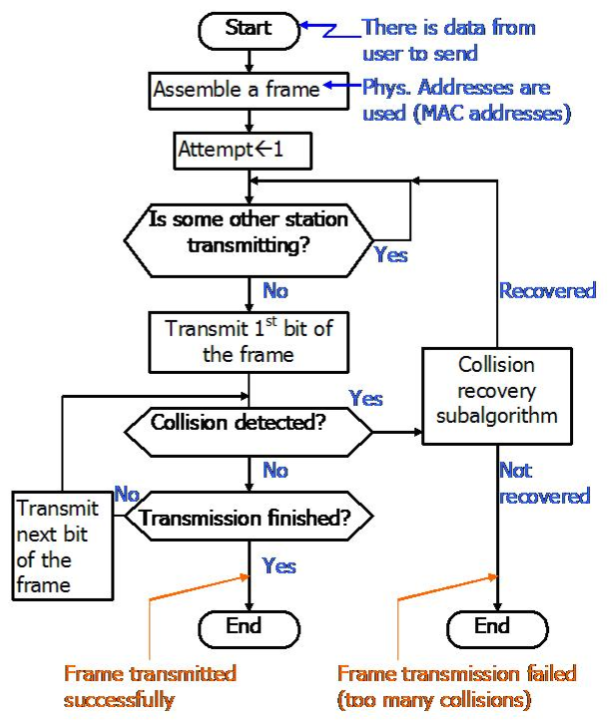
  

<!-- study-only:end -->

---

## Porównanie

  
<strong>ALOHA</strong>nadaj, potem reaguj proste systemy radiowe

  
<strong>CSMA</strong>nasłuchaj przed nadaniem współdzielone LAN

  
<strong>CSMA/CA</strong>staraj się uniknąć kolizji Wi-Fi

  
<strong>CSMA/CD</strong>wykryj kolizję podczas nadawania historyczny Ethernet współdzielony

