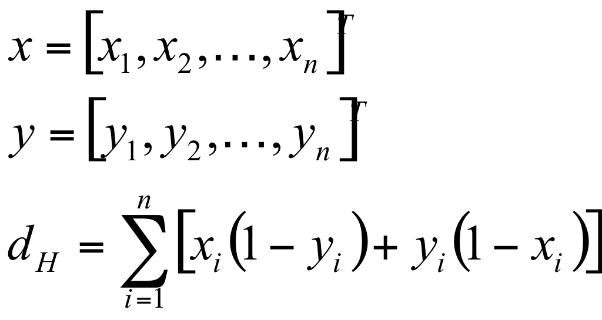
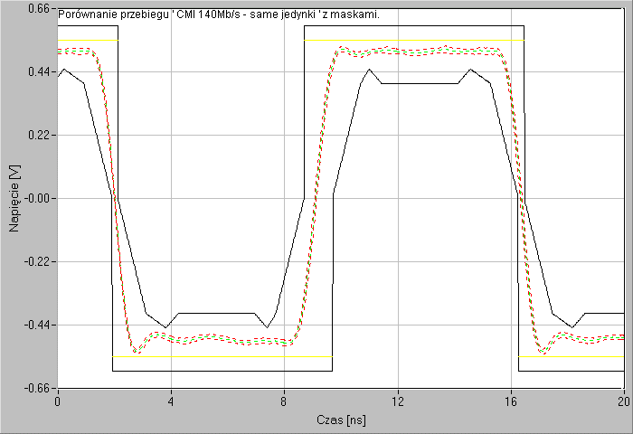
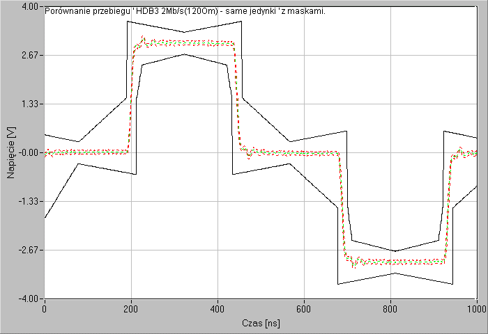
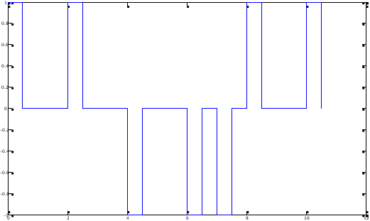
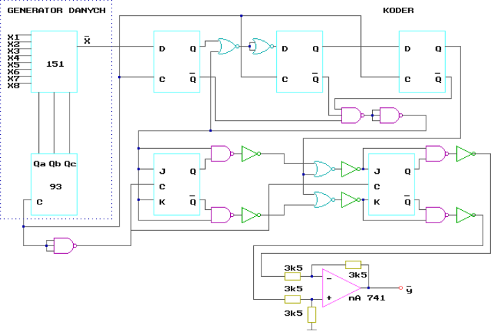
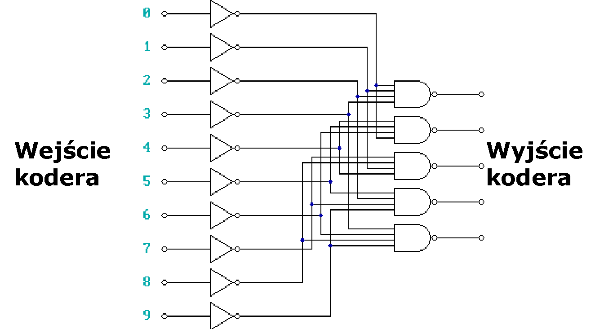
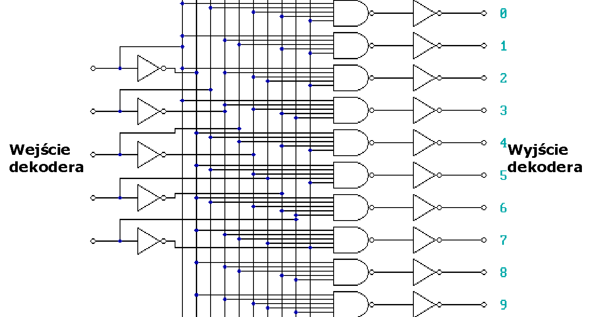
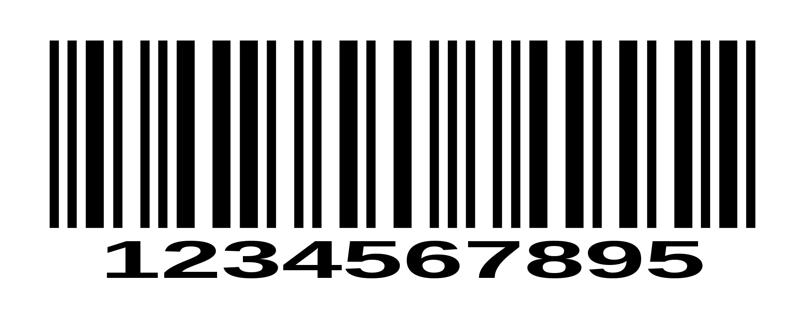

<!-- .slide: class="title-slide" -->

# Kodowanie sygnałów

Mikołaj Leszczuk

---

## Plan wykładu

- podstawowe pojęcia kodowe,
- odległość Hamminga i waga kodu,
- maski telekomunikacyjne i właściwości sygnału,
- HDB, kod „2 z 5”, kody ilorazowe i splotowe.

---

## Kod i słowo kodowe

Kod przypisuje symbolom źródłowym ciągi symboli kodowych. **Słowo kodowe** jest wynikiem takiego przypisania.

Cele kodowania obejmują między innymi reprezentację informacji, synchronizację transmisji oraz wykrywanie i korekcję błędów.

---

## Materiał: odległość Hamminga

Prowadzący porównuje dwa ciągi tej samej długości bit po bicie.

<video controls preload="metadata"><source src="media/videos/P02mJhS9qQ4.mp4" type="video/mp4"></video>

---

## Wzór na odległość Hamminga

Minimalna odległość kodu określa jego zdolność do wykrywania i korekcji błędów.

---

## Waga kodu

Waga słowa kodowego jest liczbą jego niezerowych symboli. Dla kodów binarnych oznacza po prostu liczbę jedynek.

`w(10110100) = 4`

---

## Kody systematyczne i niesystematyczne

**Systematyczne**

Słowo kodowe zawiera wprost bity informacji oraz bity kontrolne.

**Niesystematyczne**

Bity informacji nie są w słowie kodowym bezpośrednio rozpoznawalne; całość jest przekształcona.

---

## Maska telekomunikacyjna

Maska określa dopuszczalne granice parametrów sygnału w czasie, np. amplitudy i narastania zboczy.

Pomiar jest poprawny, gdy rzeczywisty przebieg pozostaje w granicach wyznaczonych przez maskę.

---

## Maska telekomunikacyjna: PDH 140 Mb/s

PDH (*Plesiochronous Digital Hierarchy*) to starsza hierarchia cyfrowa stosowana w sieciach telekomunikacyjnych.

Oryginalny przykład przedstawia nie-ramkowany sygnał **140 Mb/s** z niesymetrycznego wyjścia **75 Ω**, kodowany liniowo jako **CMI** (*Coded Mark Inversion*). Maska jest porównywana z nałożonymi przebiegami wielu impulsów.

---

## Pomiar maski PDH 140 Mb/s

  

---

## Maska telekomunikacyjna: PCM 2 Mb/s

PCM (*Pulse Code Modulation*) oznacza cyfrowe kodowanie sygnału przez próbkowanie, kwantyzację i zapis próbek.

Tu oryginalny pomiar dotyczy nie-ramkowanego sygnału **2 Mb/s** z symetrycznego wyjścia **120 Ω** i kodu **HDB3**. Nakładanie kolejnych impulsów pokazuje, czy ich amplituda i kształt mieszczą się w masce.

---

## Pomiar maski PCM 2 Mb/s

  

---

## Pożądane właściwości kodu transmisyjnego

- ograniczone składowe stałe,
- możliwość odzyskania zegara,
- mała liczba długich serii zer lub jedynek,
- odporność na błędy,
- rozsądna nadmiarowość i przepływność.

---

## Co zniekształca sygnał?

Na odbiorniku sygnał może różnić się od sygnału na wyjściu nadajnika. Przyczynami są m.in. odbicia, spadek napięcia lub mocy, nieliniowość nadajnika i odbiornika oraz wahania fazy.

---

## HDB

Kody HDB (*High Density Bipolar*) zastępują długie serie zer wzorcami zawierającymi impulsy naruszające regułę bipolarności.

Pozwala to utrzymać synchronizację bez ograniczania długości serii zer w danych.

---

## HDB-2 jako kod pseudoternarny

Sygnał danych ma dwa stany (`0`, `1`), ale sygnał liniowy używa trzech poziomów napięcia: `−V`, `0`, `+V`. Kolejne jedynki są reprezentowane naprzemiennie przez impuls dodatni i ujemny; zwykłe zero oznacza brak impulsu.

W HDB-2 zastępuje się ciąg trzech zer. Impuls **V** celowo narusza przemienność polaryzacji. Odbiornik rozpoznaje w nim znacznik zastąpionych zer, nie nową jedynkę danych.

---

## Po co HDB-2 w torze transmisyjnym?

- Dobór polaryzacji ogranicza składową stałą i energię widma blisko częstotliwości zerowej.
- Nadmiar wynikający z trzech poziomów pozwala wykryć część naruszeń oczekiwanej kolejności impulsów.

Trzy poziomy zwiększają wrażliwość na zakłócenia. Kodowanie i dekodowanie zależą od wcześniejszych impulsów, a analiza trzech kolejnych pozycji wprowadza opóźnienie. Błędna decyzja dekodera może wpłynąć na interpretację następnych symboli.

---

## Synchronizacja w HDB3

AMI (*Alternate Mark Inversion*): kolejne `1` to naprzemienne impulsy `+` i `−`, a `0` to brak impulsu.

HDB3 (*High Density Bipolar of order 3*) zastępuje cztery zera: **000V** po nieparzystej liczbie zwykłych impulsów od ostatniego V, **B00V** po parzystej. Poniżej przykład B00V.

<svg class="hdb3-wave-svg" viewBox="0 0 920 260" role="img" aria-label="Przebieg B00V: dwa dodatnie impulsy oddzielone dwoma zerami">
  <line x1="105" y1="165" x2="835" y2="165" class="axis" />
  <line x1="105" y1="55" x2="105" y2="188" class="axis" />
  <text x="65" y="67" class="level">+V</text><text x="73" y="174" class="level">0</text>
  <path d="M105 165 H145 V65 H285 V165 H565 V65 H705 V165 H835" class="wave" />
  <text x="215" y="225" class="label-b">B</text><text x="355" y="225" class="symbol">0</text><text x="495" y="225" class="symbol">0</text><text x="635" y="225" class="label-v">V</text>
</svg>

<strong>B</strong>zwykły impuls zgodny z AMI

<strong>V</strong>impuls o tej samej polaryzacji, celowo naruszający AMI

---

## Koder HDB-2: realizacja logiczna

Rejestry i bramki logiczne śledzą wcześniejsze impulsy, wybierają polaryzację i wprowadzają impuls naruszający regułę przemienności po długiej serii zer.

---

## Kod stałowagowy „2 z 5"

- Każde słowo ma pięć bitów, z których dokładnie dwa mają wartość `1`.
- Jest to kod nieliniowy i stałowagowy.
- Nie każde pięciobitowe słowo jest prawidłowe, co umożliwia wykrywanie części błędów.

---

## Dopuszczalne słowa kodu „2 z 5”

Każda z dziesięciu kombinacji dwóch jedynek na pięciu pozycjach jest prawidłowa:

| | | | | |
| --- | --- | --- | --- | --- |
| `01100` | `11000` | `10100` | `10010` | `01010` |
| `00110` | `10001` | `01001` | `00101` | `00011` |

Przypisanie słów do cyfr jest umową konkretnego wariantu kodowania.

---

## Odporność na błędy kodu „2 z 5”

Minimalna odległość Hamminga między prawidłowymi słowami wynosi **2**. Każdy błąd jednego, trzech lub pięciu bitów zmienia wagę słowa, więc dekoder go wykryje. Samo wykrycie nie oznacza, że potrafi wskazać poprawną cyfrę.

Dla błędów dwóch i czterech bitów test wagi wykrywa **40%** przypadków. Na przykład przy dwóch przekłamaniach sześć z dziesięciu par pozycji zamienia jedną `1` na `0` i jedno `0` na `1`; waga nadal wynosi wtedy dwa, więc taki błąd pozostaje niewykryty.

---

## Koder i dekoder „2 z 5”

**Koder**

Mapuje symbol wejściowy na jedno z dopuszczalnych słów o wadze dwa.

**Dekoder**

Sprawdza wagę słowa, rozpoznaje kod i sygnalizuje nieprawidłową kombinację.

---

## Schemat kodera „2 z 5”

  

---

## Schemat dekodera „2 z 5”

  

---

## Zastosowanie kodu „2 z 5”

Historyczne zastosowania obejmują centrale telefoniczne (przesyłanie cyfr wybieranego numeru), dawne systemy komputerowe oraz kody kreskowe *Interleaved 2 of 5*, używane między innymi do oznaczania przesyłek i produktów.

---

<!-- .slide: class="section-slide" -->

# Kodowanie ilorazowe

---

## Bity jako wielomian

Ciąg `10101` można zapisać jako `h(x) = x⁴ + x² + 1`: pozycje jedynek wyznaczają potęgi `x`.

Obliczenia wykonuje się nad `GF(2)`. Współczynniki mają wartości `0` lub `1`, a dodawanie i odejmowanie są operacją XOR.

---

## Wielomiany w kodzie ilorazowym

- `h(x)` — wielomian informacji,
- `g(x)` — wielomian generujący o stopniu `p`,
- `s(x)` — przesyłane słowo kodowe.

Przy dekodowaniu dzielimy odebrane słowo przez `g(x)`. **Zerowa reszta** oznacza słowo zgodne z regułą kodu; nie dowodzi jednak, że w transmisji nie wystąpił żaden błąd.

---

## Kodowanie niesystematyczne

Koder mnoży wielomian informacji przez wielomian generujący:

`s(x) = h(x) · g(x)`

Wynik jest podzielny przez `g(x)`, ale bity informacji nie muszą zajmować osobnego, niezmienionego fragmentu słowa kodowego.

---

## Dekodowanie niesystematyczne

Dekoder dzieli odebrane `y(x)` przez `g(x)`:

`y(x) = q(x) · g(x) + r(x)`

- `r(x) = 0`: słowo spełnia regułę kodu, a iloraz `q(x)` odtwarza informację.
- `r(x) ≠ 0`: wykryto błąd zgodnie z możliwościami tego kodu.

---

## Kodowanie systematyczne

Bity informacji zostają na początku słowa. Przesuwamy je o `p` pozycji i wyznaczamy `p` bitów kontrolnych:

`R(x) = reszta z [xᵖ · h(x)] / g(x)`

`s(x) = xᵖ · h(x) − R(x)`

W `GF(2)` odejmowanie jest XOR. Dlatego uzyskane `s(x)` dzieli się przez `g(x)` bez reszty, a pierwsze bity nadal zapisują `h(x)`.

Przykład: `h = 10101`, `g = 1011`, `p = 3` → `xᵖh = 10101000`, `R = 101`, `s = 10101101`.

---

## Dekodowanie systematyczne

Odebrane słowo dzielimy przez `g(x)` i sprawdzamy resztę. Gdy wynosi zero, część informacyjna to pierwsze `k` bitów słowa kodowego.

`10101101 ÷ 1011` daje resztę `000`; odczytana informacja to `10101`, a bity kontrolne to `101`.

Niezerowa reszta sygnalizuje błąd wykrywalny przez ten kod.

---

## Kod splotowy

Kodowanie splotowe (*convolutional coding*) tworzy ciąg wyjściowy zależny od bieżących i wcześniejszych bitów wejściowych.

Stan kodera jest pamięcią wcześniejszych symboli, a dekodowanie wybiera najbardziej prawdopodobną sekwencję wejściową.

---

## Kodowanie splotowe: intuicja

  
<strong>Wejście</strong><code>u(k)</code><small>bieżący bit</small>

  
→

  
<strong>Rejestr</strong><code>u(k−1), u(k−2)</code><small>bity z poprzednich chwil</small>

  
→

  
<strong>Generatory</strong><code>XOR mod 2</code><small>alternatywa wykluczająca: wynik 1, gdy bity są różne</small>

  
→

  
<strong>Wyjście</strong><code>c₁(k), c₂(k)</code><small>bity kodowe</small>

---

## Przykład kodera splotowego `1/2`

  
Rejestr przesuwny: po każdej chwili bit przesuwa się o jedno miejsce w prawo

  

    
<code>u(k)</code><small>bieżący bit</small>
→
    
<code>u(k−1)</code><small>pamięć 1</small>
→
    
<code>u(k−2)</code><small>pamięć 2</small>

  

  

    
<strong>Generator 1</strong>
<code>u(k)</code><b>⊕</b><code>u(k−1)</code><b>⊕</b><code>u(k−2)</code><b>→</b><code>c₁(k)</code>

    
<strong>Generator 2</strong>
<code>u(k)</code><b>⊕</b><code>u(k−2)</code><b>→</b><code>c₂(k)</code>

  

Generatory korzystają z różnych odczepów rejestru, więc dają dwa różne sprawdzenia tej samej historii wejścia. Na jeden bit wejściowy przypadają dwa bity wyjściowe, stąd szybkość kodu `1/2`.

---

## Co daje nadmiarowość?

Z jednego bitu `u(k)` powstaje para `c₁(k), c₂(k)`. Jeżeli zakłócenie zmieni jeden symbol, drugi symbol oraz zależność od poprzednich chwil pomagają dekoderowi wybrać najbardziej prawdopodobny ciąg wejściowy.

  

u(k)
<strong>1 bit wejściowy</strong>

  
→

  

c₁(k)c₂(k)
<strong>2 bity kodowe</strong>

  
→

  

?
<strong>więcej wskazówek dla dekodera</strong>

Liczba generatorów dobierana jest jako kompromis: większa nadmiarowość zwiększa odporność, ale zajmuje więcej pasma.

---

## Systematyczne a niesystematyczne kodowanie splotowe

- W wersji systematycznej jeden z bitów wyjściowych jest kopią bitu wejściowego.
- W wersji niesystematycznej wszystkie bity wyjściowe są kombinacjami bieżącego i zapamiętanych bitów.
- Oba podejścia są używane zależnie od wymagań systemu i dekodera.

---

## Podsumowanie

- Odległość Hamminga i waga pomagają opisać właściwości kodu.
- Kody transmisyjne mogą wspierać synchronizację i odporność na błędy.
- HDB, „2 z 5”, kody ilorazowe i splotowe rozwiązują różne problemy transmisyjne.

<!-- study-only:start -->

---

# Materiały do samodzielnej nauki

Ta część jest dostępna w dokumencie Markdown, poza pokazem slajdów.

---

## Sprawdź: odległość Hamminga

Odległość Hamminga to liczba pozycji, na których dwa ciągi o tej samej długości się różnią.

Przykłady: `d(10001, 10000) = 1`, `d(00010, 10100) = 3`.

  <label>Pierwszy ciąg<input class="hamming-x" value="10001" inputmode="numeric" maxlength="16"></label>
  <label>Drugi ciąg<input class="hamming-y" value="10000" inputmode="numeric" maxlength="16"></label>
  

---

## HDB3: spróbuj sam

  <label>Ciąg binarny<input class="hdb3-input" value="100000001" inputmode="numeric" maxlength="20"></label>
  

---

## Generator kodu „2 z 5”

  <label>Cyfra wejściowa<input class="two-of-five-digit" type="number" value="6" min="0" max="9" step="1" inputmode="numeric"></label>
  

---

## Sprawdź słowo „2 z 5”

  <label>Słowo pięciobitowe<input class="two-of-five-word" value="01100" inputmode="numeric" maxlength="5"></label>
  

---

## Koder splotowy: spróbuj sam

  <label>Ciąg wejściowy<input class="convolutional-input" value="10110" inputmode="numeric" maxlength="12"></label>
  

<!-- study-only:end -->
