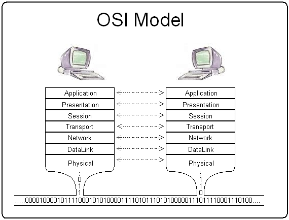
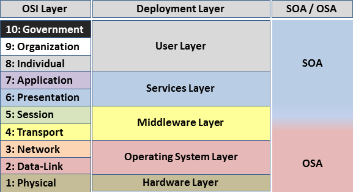
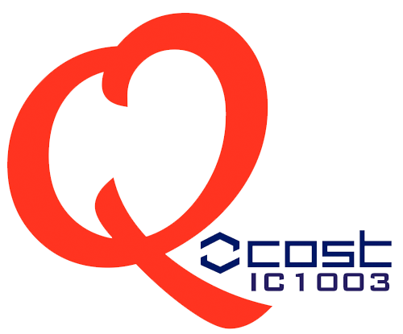
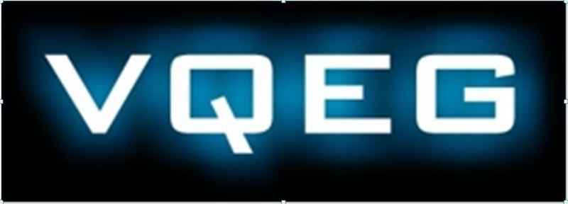
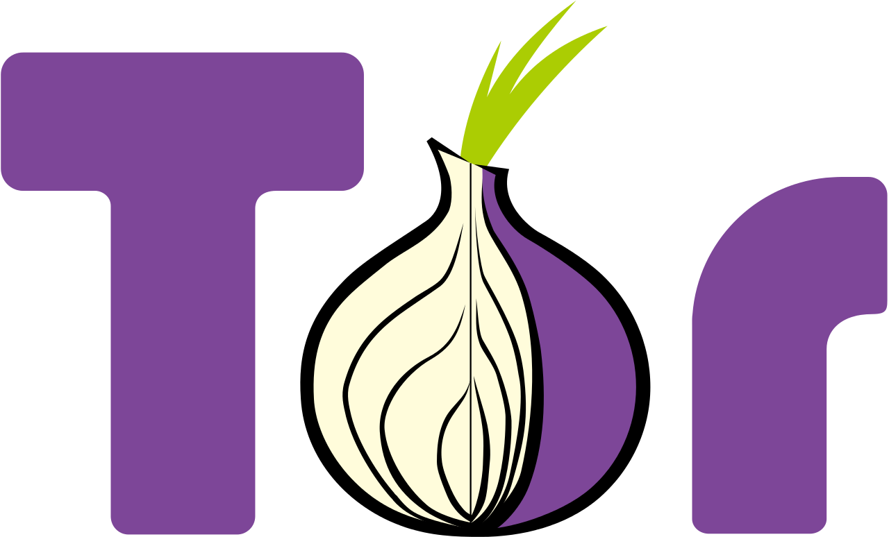
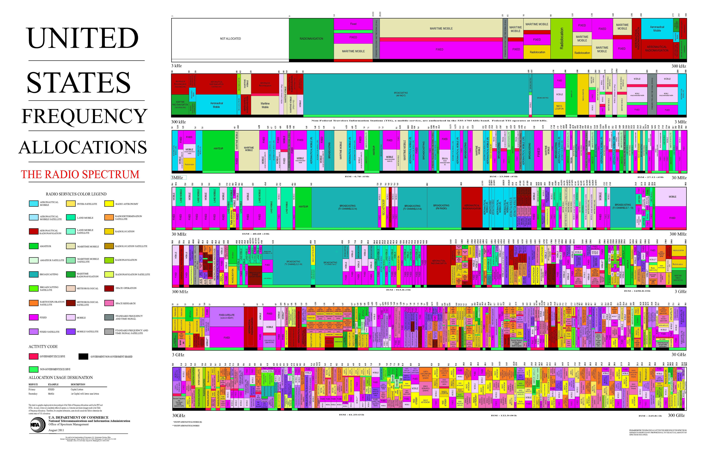
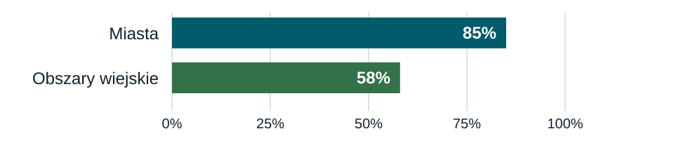
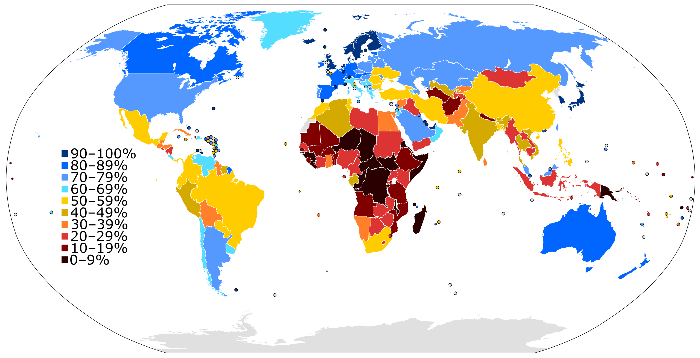

# Człowiek, ósma warstwa modelu ISO-OSI, jako element ekosystemu teleinformatycznego

Mikołaj Leszczuk

---

## Plan wykładu

1. Ekosystem teleinformatyczny i rola człowieka
2. Jakość usług z perspektywy odbiorcy
3. Neutralność sieci
4. Prywatność i anonimowość
5. Zarządzanie widmem
6. Integracja i wykluczenie cyfrowe

---

## Dlaczego mówimy o ekosystemie?

Greckie *oikos* to dom, a *systēma* to zestawienie. Ekosystem to dynamiczny układ organizmów, ich relacji i środowiska. Zachodzą w nim przepływ energii i obieg materii.

Fot. Richard Ling, 2004, <a href="https://creativecommons.org/licenses/by-sa/3.0/">CC BY-SA 3.0</a>.

---

## Ekosystem jest społeczny i techniczny

**Od strony technicznej**

Urządzenia, sieci i usługi są rozproszone. Mogą się rozwijać i dostosowywać bez przebudowy całego systemu.

**Od strony społecznej**

Podmioty współpracują nad standardami, ale konkurują o użytkowników. Reguły dostępu wpływają na to, kto może skorzystać z usługi.

---

## Od ekosystemu naturalnego do cyfrowego

- **Samoorganizacja:** uczestnicy tworzą relacje i usługi bez centralnego planu.
- **Skalowalność:** system dostosowuje się do wzrostu liczby użytkowników.
- **Zrównoważony rozwój:** długofalowe funkcjonowanie zależy od zasobów i reguł współpracy.

Modele inspirowane przyrodą pomagają badać zarówno współpracę, jak i konkurencję.

---

## Siedem warstw i użytkownik

| Poziom | Co opisuje? |
| :--- | :--- |
| Użytkownik | Cel, oczekiwania i warunki korzystania |
| 7-5 | Aplikacja, prezentacja danych, sesja |
| 4-3 | Transport danych i trasowanie |
| 2-1 | Łącze danych, sygnał i medium |

**Ósma warstwa to metafora**, nie część formalnego modelu ISO/OSI.

---

## Jak komunikują się warstwy ISO/OSI?

---

## Rozszerzenie modelu jako ilustracja

To propozycja ilustracyjna, nie standard. Gvseostud, <a href="https://commons.wikimedia.org/w/index.php?curid=29156115">Wikimedia Commons</a>, CC BY-SA 3.0.

---

## Kto wpływa na siedem warstw?

- **Użytkownik** wybiera cel i sposób korzystania z usługi.
- **Dostawca** decyduje, jak aplikacja reaguje na słabe łącze.
- **Instytucje publiczne** ustalają m.in. zasady dostępu do sieci i korzystania z widma.

Przykład: wdrożenie sieci bezprzewodowej zależy zarówno od technologii radiowej, jak i od tego, gdzie i na jakich zasadach można nadawać.

---

## Użytkownik ocenia usługę

**QoE (Quality of Experience)** to jakość doświadczana przez użytkownika. Liczy się nie tylko dostarczenie danych, ale też to, czy usługa spełnia jego oczekiwania.

Przerwa w transmisji może przeszkadzać inaczej widzowi filmu niż uczestnikowi zajęć na żywo. Pomiar tych różnic omawiamy w osobnym wykładzie.

---

## Oczekiwania i użyteczność

Według białej księgi QUALINET QoE opisuje stopień zadowolenia lub irytacji. Widz odnosi użyteczność i satysfakcję do swoich oczekiwań oraz aktualnych preferencji.

W badaniach jakości wideo działa m.in. Video Quality Experts Group (VQEG).

---

## QoE w ekosystemie mediów

| Element | Pytanie z perspektywy odbiorcy |
| :--- | :--- |
| Treść | Czy materiał odpowiada moim potrzebom? |
| Dostarczanie | Czy odtwarzanie działa bez zbędnych przerw? |
| Użyteczność i interakcja | Czy mogę obsłużyć usługę tak, jak potrzebuję? |
| Model biznesowy | Czy cena i warunki są do przyjęcia? |

---

## Neutralność sieci: o co chodzi?

Czy operator powinien móc spowolnić usługę wideo konkurenta mimo tego, że użytkownik ma działające łącze?

Zasada otwartego internetu dotyczy m.in. niedyskryminacyjnego traktowania ruchu, niezależnie od nadawcy, odbiorcy, treści, aplikacji czy urządzenia.

Źródło: art. 3 rozporządzenia UE 2015/2120.

---

## Formy różnicowania dostępu

**Względem czego?** Użytkownika, adresu, systemu operacyjnego, aplikacji, urządzenia lub sposobu komunikacji.

**Jak?** Przez zmianę opłat, spowalnianie ruchu albo blokowanie dostępu. To różne mechanizmy i ocenia się je oddzielnie.

---

## Zarządzanie ruchem a dyskryminacja

**Zarządzanie techniczne**

Może wynikać z obiektywnych wymagań technicznych, nie ze względów handlowych. Reguły powinny być przejrzyste, proporcjonalne i niedyskryminacyjne.

**Dyskryminacja**

Celowe spowalnianie wideo konkurenta ze względów handlowych to inny przypadek niż uwzględnienie wymagań technicznych całej kategorii ruchu.

Sama różnica w sposobie obsługi pakietów nie rozstrzyga, czy zasada została naruszona.

---

## Wyjątki od jednakowego traktowania ruchu

Artykuł 3 dopuszcza odstępstwa tylko w niezbędnym zakresie i czasie, m.in. w celu wykonania obowiązku prawnego, ochrony bezpieczeństwa sieci lub rozwiązania wyjątkowego albo przejściowego przeciążenia.

Przy przeciążeniu równoważne kategorie ruchu trzeba traktować jednakowo.

---

## Prywatność, anonimowość, pseudonim

- **Prywatność:** kto uzyskuje dane o mnie i co może z nimi zrobić?
- **Anonimowość:** czy obserwator może powiązać działanie z moją tożsamością?
- **Pseudonimowość:** obserwator widzi stały identyfikator, ale niekoniecznie zna osobę.

Szyfrowanie chroni treść wiadomości, ale nie musi ukrywać stron komunikacji.

---

## Ochrona prywatności w praktyce

Ochrona może wynikać z prawa, zasad organizacyjnych i metod technicznych, takich jak kryptografia. Electronic Frontier Foundation to jeden z przykładów organizacji zajmujących się prawami cyfrowymi.

---

## Co widzi usługa internetowa?

Adres IP, cechy przeglądarki i systemu, a czasem także informacje o czcionkach lub ekranie. Zestaw cech może działać jak **odcisk przeglądarki**.

Zalogowanie się na konto pozwala powiązać aktywność z kontem niezależnie od adresu IP.

To, co serwis widzi w trakcie połączenia, nie musi być tym, co zapisuje ani co potrafi później powiązać z konkretną osobą.

---

## Co zmienia VPN, a co Tor?

**VPN: wirtualna sieć prywatna**

Jeśli ruch przechodzi przez tunel, usługa widzi adres wyjścia VPN. Zaufanie częściowo przenosi się na operatora VPN.

**Tor: trasowanie cebulowe**

Przekaźnik wejściowy zna adres użytkownika. Przekaźnik wyjściowy łączy się z usługą. Role są rozdzielone.

Żadne z tych narzędzi nie ukrywa tożsamości ujawnionej przez samego użytkownika.

---

## Trasowanie cebulowe

Warstwy szyfrowania sprawiają, że kolejne przekaźniki zdejmują tylko przeznaczoną dla siebie warstwę informacji o trasie.

---

## Dlaczego zarządzamy widmem?

Nadajniki mogą sobie przeszkadzać, gdy używają tej samej częstotliwości na tym samym obszarze.

Zarządzanie widmem godzi różne potrzeby: łączność publiczną, radio i telewizję, bezpieczeństwo, naukę i dostęp bez indywidualnych rezerwacji.

---

## Jak czytać Krajową Tablicę?

| Zakres | Przeznaczenie | Użytkowanie |
| :--- | :--- | :--- |
| 87,5-108 MHz | Radiodyfuzja | Cywilne |

Wiersz 222 polskiej tablicy określa przeznaczenie zakresu, w którym działa radiofonia FM. Nie mówi, która stacja może nadawać na 101,5 MHz w danym mieście. Do tego potrzebne są informacje o konkretnym przydziale.

---

## Jak wygląda pełny wykres widma?

Archiwalny wykres podziału widma w USA, z materiałów EET. Kliknij, aby powiększyć. W Polsce obowiązuje krajowa tablica.

---

## Wykluczenie cyfrowe: więcej niż zasięg

- **Dostęp:** czy jest łącze i odpowiednie urządzenie?
- **Koszt:** czy można sobie pozwolić na regularne korzystanie?
- **Kompetencje:** czy użytkownik potrafi wykonać potrzebne zadanie?
- **Dostępność:** czy serwis działa np. z czytnikiem ekranu?

---

## Lokalnie i globalnie

**Lokalnie:** w tej samej miejscowości warunki korzystania mogą się różnić ze względu na wiek, dochód, kompetencje czy dostępność urządzeń.

Korzystanie z internetu na świecie w 2025 r. Źródło: ITU (Międzynarodowy Związek Telekomunikacyjny).

---

## Polska: wiek a korzystanie z internetu

Które grupy korzystają z internetu przynajmniej raz w tygodniu niemal powszechnie? W której grupie spodziewasz się największej różnicy?

Grupy w badaniu GUS: 16-24, 25-34, 35-44, 45-54, 55-64 i 65-74 lata.

---

## Polska: wyniki według wieku

| Wiek | 16-24 | 25-34 | 35-44 | 45-54 | 55-64 | 65-74 |
| :--- | ---: | ---: | ---: | ---: | ---: | ---: |
| Regularnie | 99,5% | 98,5% | 98,2% | 94,4% | 84,4% | 58,8% |

Które dwie grupy różnią się najbardziej? Czy z tej tabeli da się stwierdzić, dlaczego?

Polska, 2025 r. Regularnie: co najmniej raz w tygodniu. <a href="https://stat.gov.pl/files/gfx/portalinformacyjny/pl/defaultaktualnosci/5497/1/19/1/spoleczenstwo_informacyjne_w_polsce_2025.pdf#page=134">GUS, tablica 34</a>.

---

## Jak wyglądało porównanie globalne?

Mapa historyczna, dane ITU z lat 2010-2012, nie opis stanu obecnego. Jeff Ogden, <a href="https://commons.wikimedia.org/w/index.php?curid=19202338">Wikimedia Commons</a>, CC BY-SA 3.0.

---

## Przykład: zajęcia online

Student ma dostęp do internetu, ale ogląda wykład na telefonie i ma ograniczony pakiet danych.

1. Czy da się wybrać niższą jakość lub odsłuchać sam dźwięk?
2. Czy napisy i materiały są czytelne na małym ekranie?
3. Czy można wrócić do treści mimo przerwy w łączu?

---

## Co wnosi ósma warstwa?

Parametry sieci odpowiadają na pytanie, jak technicznie działa usługa.

Perspektywa człowieka dodaje pytania: **dla kogo działa, w jakich warunkach i na jakich zasadach?**

<!-- study-only:start -->

### Źródła

- Mikołaj Leszczuk, *Człowiek, ósma warstwa modelu ISO/OSI, jako element ekosystemu teleinformatycznego*, materiały EET AGH (2023) i archiwalny wykład 13 PT (2019).
- [Rozporządzenie UE 2015/2120, art. 3](https://eur-lex.europa.eu/eli/reg/2015/2120/oj).
- [Krajowa Tablica Przeznaczeń Częstotliwości, Dz.U. 2026 poz. 1482](https://eli.gov.pl/eli/DU/2026/1482/ogl).
- [ITU, Facts and Figures 2025: dostęp w miastach i na obszarach wiejskich](https://www.itu.int/itu-d/reports/statistics/2025/10/15/ff25-internet-use-in-urban-and-rural-areas/).

Archiwalne wykresy wieku z PT i EET mają różne liczby i nie podają tu porównywalnej daty, populacji ani definicji wskaźnika. Zamiast traktować je jak wyniki współczesnego pomiaru, zachowano zadanie porównania grup wiekowych i wstawiono sprawdzalne dane GUS.

<!-- study-only:end -->
